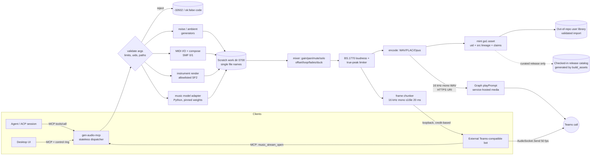

# Music, background audio and layering: technical spec (v0.1 draft)

| | |
|---|---|
| Status | **Documentation-only proposal; no music implementation.** This draft defines future music, ambient-audio and layering work; it does not implement or enable any of it. No music crate, music MCP tool, model adapter, codec, MIDI path or frame server is added by this document. |
| Audience | DarbotLabs engineers and coding agents evaluating a future implementation |
| Intended repo path | `docs/MUSIC_GENERATION_SPEC.md` |
| Baseline inspected | Local `main` at `e7603537289f69e45199395cf9d6d4371896bb60`; `origin/main` is `7fa121cd9b79bf1382e7f80730f2555f8afdcb44`. `e760353` only updates desktop Vite and `fast-uri` dependencies, so the product-code facts below are current at both revisions. |
| Evidence scope | Current claims are based on the tracked tree at the baseline. External Teams and model facts are recommendations that must be re-verified at implementation time. |
| Normative words | MUST, MUST NOT, SHOULD and MAY are used as in RFC 2119 |

> **Reading rule.** “Current” means present in the baseline. “Proposed” means
> absent until a listed Level is implemented. The unified `ga1` asset model is
> already on `main`; the proposed music kinds are not. A proposed API, path,
> model, codec or dependency is never a claim of current functionality.

---

## 0. Inventory: what exists today (evidence)

Every **current-path** citation in this section exists in the baseline. “Absent”
means there is no dedicated reusable implementation in the tracked main tree;
test data, prose, external-service response handling and the narrow AgentYankers
cue path are called out instead of being mistaken for a music subsystem.

### 0.1 Audio generation

| Area | What exists | Current evidence |
|---|---|---|
| Speech synthesis | Multiple speech adapters now exist. Kokoro ONNX and DarbotLM Kokoro concatenate timed or per-turn speech; VibeVoice, VibeVoice realtime/livevoice, Magpie, Pocket TTS and per-speaker `adaptive` routing have adapter paths. Availability is probed from the configured runtime and local weights; a missing dependency refuses rather than writing substitute speech. | `src/gen_audio/adapters.py`, `src/gen_audio/synth_kokoro_onnx.py`, `src/gen_audio/voices/runtime.py`, `src/gen_audio/speakers.py`, `docs/ARCHITECTURE.md` |
| Engine / voice registries | `gen_audio.engines` is capability metadata and `schemas/voices/registry.v1.json` is the framework registry. Python adapters, Rust status metadata, voice descriptors and a cross-language catalog are present; this is a speech/voice system, not a music-model registry. | `src/gen_audio/engines.py`, `crates/gen-audio-core/src/engines.rs`, `schemas/voices/registry.v1.json`, `src/gen_audio/voices/`, `crates/gen-audio-core/src/voices.rs` |
| Adaptive voice framework | `adaptive` is implemented as speech routing: each cast speaker selects a registered speech framework and the resulting mono waveforms are normalized and joined. It is not a music framework and does not load a music model. | `src/gen_audio/adapters.py`, `src/gen_audio/cast.py`, `schemas/voices/cast_map.v1.schema.json` |
| Procedural cue / bed path | AgentYankers has deterministic mono 24 kHz laugh, two-note stinger and one-pole smoothed-noise bed functions. The episode mixer concatenates program segments and adds a gain-scaled, looped bed. This is show-specific fixed DSP, not a public noise/ambient/music generator or a general mixer. | `src/gen_audio/agentyankers/beds.py`, `src/gen_audio/agentyankers/episode.py`, `src/gen_audio/engines.py`, `docs/AGENTYANKERS.md` |
| Fixture tone | Rust writes a labeled 16 kHz mono PCM16 sine (40 Hz + 440 Hz), with 80 ms silence at each edge and an explicit non-speech sidecar. It uses a hand-written RIFF/WAV encoder for the fixture only. | `crates/gen-audio-core/src/fixture.rs`, MCP `fixture_tone` in `crates/gen-audio-mcp/src/lib.rs` |
| Browser test signals | The desktop builds synthetic in-memory buffers for an in-window DFT/profile map. They are UI signals, not file output and not music generation. | `apps/desktop/src/signal.ts`, `apps/desktop/src/profiles.ts` |
| General music, instruments, colored noise or ambient scenes | **No reusable music subsystem.** The narrow AgentYankers bed/stinger path above is the only current procedural background-audio implementation. There are no genre controls, colored-noise APIs, ambient-scene generator APIs, GM instruments or instrument renderer. | `src/gen_audio/agentyankers/beds.py`; tracked dependency manifests `Cargo.toml`, `pyproject.toml`, `apps/desktop/package.json` |
| MIDI (files, devices, GM) | **Absent** as a current feature: no MIDI parser/writer, device bridge, UMP path or MIDI dependency in tracked product code. | `Cargo.toml`, `pyproject.toml`, `apps/desktop/package.json` |
| SoundFont / SF2 | **Absent** as a current feature: no bank registry, renderer or SF2 dependency. | `Cargo.toml`, `pyproject.toml` |
| Music-generation models | **Absent.** No ACE-Step, MusicGen, Magenta, symbolic composer or other music adapter is registered. VibeVoice descriptors containing a `_bgm` tag remain voice-reference metadata, not a music-generation API. | `schemas/voices/registry.v1.json`, `voices/vibevoice/en-Mary_woman_bgm.json`, `src/gen_audio/engines.py` |

### 0.2 Encoding, sample rates and I/O

| Area | What exists | Current evidence |
|---|---|---|
| Python WAV/audio I/O | `read_wav` uses `soundfile` and returns mono float32 (stereo is averaged by `as_mono`). `write_wav` writes mono only, PCM_16 by default or `FLOAT`. There is no general stereo writer. | `src/gen_audio/audio_io.py` |
| Rust WAV writer | Mono PCM16 RIFF output exists only in the labeled fixture writer. | `crates/gen-audio-core/src/fixture.rs` |
| Other codec I/O | The external speech-response boundary accepts WAV, FLAC, MPEG and Ogg media types through `soundfile`/libsndfile and decodes them to mono. That is response decoding, not a music encode pipeline. The optional video path uses `ffmpeg` to mux WAV audio as AAC into MP4. Local Gen Audio audio publishing still writes WAV; no dedicated FLAC/Opus/MP3 encoder is implemented. | `src/gen_audio/speech_client.py`, `src/gen_audio/video_render.py`, `pyproject.toml` |
| 24 kHz speech publish chain | `improve()` is fixed, speech-specific DSP: trim silence → 70 Hz zero-phase Butterworth high-pass → peak normalize to 0.89 → `scipy.signal.resample_poly` to 24 kHz. AgentYankers and the shipped speech path are also mono 24 kHz. This chain MUST NOT silently become the music/beds chain. | `src/gen_audio/improve.py`, `src/gen_audio/agentyankers/contract.py`, `docs/ARCHITECTURE.md` |
| Sample-rate / identity facts | The `ga1` envelope and migration code extract `audio_clip` rate, duration and 1..32 channels from WAV headers. Duration and cube identity use the current integer/JCS and round-half-up rules. | `crates/gen-audio-core/src/asset.rs`, `crates/gen-audio-core/src/asset_migrate.rs`, `docs/ASSET_OBJECT_MODEL.md`, `src/gen_audio/identity.py` |
| Resampling | Python `scipy.signal.resample_poly` is used for the speech publish and adapter joins. There is no deterministic Rust music resampler. | `src/gen_audio/improve.py`, `src/gen_audio/adapters.py` |
| Loudness / peaks | The Python publish path still uses sample peak (0.89 target), RMS/peak inv-HDR and clip fraction. The optional Rust `master_audio` MCP action separately runs FFmpeg two-pass BS.1770 `loudnorm` mastering at -16 LUFS/-1.5 dBTP/LRA 4 with an independent final measurement; it does not claim music synthesis or replace the Python chain. | `src/gen_audio/improve.py`, `src/gen_audio/cube_revision.py`, `crates/gen-audio-core/src/mastering.rs` |
| Media limits | Asset media is capped at 256 MiB in `verify_media`. The realtime speech response decoder independently caps its response at 64 MiB. | `crates/gen-audio-core/src/asset.rs`, `src/gen_audio/speech_client.py` |

### 0.3 Mixing, layering and playback

| Area | What exists | Current evidence |
|---|---|---|
| Mixing / joining | Narrow operations exist: turn concatenation in speech adapters; AgentYankers' mono bed add and loop; and `widen_band`, which blends a high-passed copy of the same buffer. There is no source graph, pan, mute/solo, offset/trim API, sidechain duck envelope, master bus or reusable mix project. AgentYankers' fixed `gain_db` is not a substitute. | `src/gen_audio/adapters.py`, `src/gen_audio/speakers.py`, `src/gen_audio/agentyankers/episode.py`, `src/gen_audio/cube_revision.py` |
| “Layers” in the asset model | The current `layer` kind means one of four **analysis** layers (`signal`, `tonality`, `confidence`, `quality`) attached to a cube. It is not an audio track; the future mix layer/track naming collision still matters. | `docs/ASSET_OBJECT_MODEL.md`, `src/gen_audio/cube_layers.py` |
| Playback | One `HTMLAudioElement` per library clip is managed through a map, with play/pause/seek, a single clock source, cube synchronization and `ui_seek_report`. There is no Web Audio graph, gain node, pan node or live mix preview. | `apps/desktop/src/playback.ts`, `apps/desktop/src/play-control.ts`, `apps/desktop/src/livestrip.ts` |
| Desktop CSP | `media-src 'self' blob:` is present. `connect-src` is limited to the app, IPC and explicit loopback ports 8765–8770; Web Audio is not yet used. | `apps/desktop/src-tauri/tauri.conf.json` |
| Livetiles / cube / generated clips | The desktop reads the unified release `assets.json`; the user-library importer adds generated speech clips; voice-model cards have Cube tabs, and render code provides flipcards and transports. This UI has no music kinds. | `apps/desktop/src/library-assets.ts`, `apps/desktop/src/render.ts`, `crates/gen-audio-core/src/library_store.rs` |

### 0.4 Assets, tools, jobs, voices and release safety

| Area | What exists | Current evidence |
|---|---|---|
| Unified asset model | `ga1` v1 is on `main`, with 10 closed kinds, content-addressed uids, `src` lineage, media/hash checks, a 256 MiB cap, honesty invariants, Rust and TS validators and pinned vectors. The longest current uid is 44 chars. This resolves the former branch dependency; music kinds remain a future schema minor. | `docs/ASSET_OBJECT_MODEL.md`, `schemas/asset-object.schema.json`, `crates/gen-audio-core/src/asset.rs`, `crates/gen-audio-core/src/asset_migrate.rs`, `apps/desktop/src/asset.ts` |
| Release and user libraries | `build_assets` creates the checked-in release catalog and a separate dev-fixture set; CI runs the regen gate and the release/stub-label gate. `library_store` atomically imports completed generated speech into an out-of-repo user library. Music is not eligible for either path today because no music envelope kinds or writers exist. | `crates/gen-audio-core/examples/build_assets.rs`, `crates/gen-audio-core/src/library_store.rs`, `src/gen_audio/release_gate.py`, `apps/desktop/public/library/assets.json`, `schemas/asset-object/fixtures/assets.dev.json`, `.github/workflows/ci.yml` |
| MCP server | Main registers 35 stateless JSON-RPC tools over stdio or loopback HTTP. Schemas use `additionalProperties:false`, and `allowed_arguments` parity is tested. This includes guarded local/provider script-authoring tools and `master_audio`, but there are still no music, MIDI, mix or stream tools. | `crates/gen-audio-mcp/src/lib.rs`, `crates/gen-audio-mcp/src/http.rs`, `crates/gen-audio-mcp/src/authoring.rs`, `docs/ARCHITECTURE.md`, `docs/CONNECTORS.md` |
| Refusal / errors | Speech refusal uses an explicit `{ok:false, synthesized...false, phase:"refused"}` payload; `isError` follows `ok:false`. Invalid calls use JSON-RPC `-32602`; asset lookup uses `asset_not_found` / `asset_ambiguous_prefix`. | `crates/gen-audio-mcp/src/lib.rs`, `crates/gen-audio-mcp/src/assets.rs`, `docs/ASSET_OBJECT_MODEL.md` |
| Generation jobs | `ui_generate` returns a process-local `job-*` id, records queued/running/refusal/done state in the viewport reducer, supports cancellation and timeout, publishes progress/job events on the bounded control ring, and imports the resulting `audio_clip` only after completion. No durable scheduler, queue cap, retention policy or generic multi-kind job service exists. | `crates/gen-audio-mcp/src/control.rs`, `crates/gen-audio-core/src/viewport.rs` |
| Python bridge / paths | `PythonTool` is a closed enum for Improve/Spectrogram/Cube/Compare/Synth; `plan_generate` is a separate fixed argv path for generation. The trusted scripts are an allowlist, child env keys are stripped, scratch writes are single names, and later reads require a process-issued file. Current accepted scratch suffixes are WAV, JSON and PNG. | `crates/gen-audio-core/src/bridge.rs`, `crates/gen-audio-core/src/paths.rs` |
| Request / audio limits | Speech text and segment limits are hard-capped and env variables can only lower them. The narrow AgentYankers HTTP route has its own body limit, consent checks and fixed 24 kHz route contract. These are not music limits. | `src/gen_audio/guards.py`, `src/gen_audio/agentyankers/serve_route.py`, `src/gen_audio/agentyankers/contract.py` |
| Model / voice policy | Voice descriptors, registry rows and cast maps distinguish framework, model, preset and persona. Local model/voice paths are confined, downloads are opt-in/offline by default in the relevant runtimes, and SHA256 pins can be required through `GENAID_*` guards. There is no current music model policy or lock file. | `docs/VOICES.md`, `schemas/voices/registry.v1.json`, `src/gen_audio/guards.py`, `src/gen_audio/voices/` |
| Secrets / honesty | Credential-shaped strings are redacted, connector secrets are not inherited by Python children, asset `claims` are closed, `fixture:true` cannot claim synthesized speech, and release filtering excludes dev fixtures. | `crates/gen-audio-core/src/redact.rs`, `crates/gen-audio-core/src/bridge.rs`, `crates/gen-audio-core/src/asset.rs`, `apps/desktop/src/validate.ts` |
| ACP | ACP has process-lifetime or pluggable session stores, an intent-plugin registry, `ProductIntent`, `session/new assets:[uid]` (max 8), and `tool_call` updates. It has no audio/music prompt capability and no music intent plugin. | `crates/gen-audio-acp/src/lib.rs` |
| LiveKit | The AgentYankers planning layer and a `StubLiveKitTransport` exist. It validates recorded consent and reports missing integration, but it does not import the LiveKit SDK, open a room, load PersonaPlex or write audio. | `src/gen_audio/shows/agent_yankers/session.py`, `src/gen_audio/shows/agent_yankers/runner.py`, `docs/AGENT_YANKERS.md` |
| Teams | **Absent from this repository.** No Teams bot, media host, Graph client or Teams manifest is part of this baseline. Any plugin-repo or Microsoft requirement in later sections is integration guidance, not inspected main evidence. | Tracked product manifests and surfaces: `crates/`, `src/`, `apps/desktop/` |
| CI / release | Current CI covers Python, VibeVoice dependency resolution, Rust, asset/vector regen, Windows scripts and desktop/release-gate checks. This document changes none of them. | `.github/workflows/ci.yml` |

### 0.5 External Teams boundary

The previous `darbotlabs/plugins` branch and commit details are not part of the
main baseline and are not reused as evidence. Before a Level 4 implementation,
the owning Teams package, manifest, permissions and media-host implementation
MUST be re-audited at the revision that will actually integrate. Until then, §7
is a delivery recommendation only.

---

## 1. Goals

All goals below are proposed future behavior. None is implemented by this
documentation change.

1. **G1 – Background audio generation.** Render beds that sit under speech or stand alone: ambient, noise, music, or any combination.
2. **G2 – Genre music generation.** Render music from a prompt plus structured controls (genre, mood, tempo, key, duration, instrumentation), first symbolically (MIDI → instruments) and later with a pinned, license-cleared model.
3. **G3 – Background noise generation.** White, pink, brown (red), blue, violet and grey noise, plus procedural ambient textures (rain, wind, surf, stream, fire crackle, room tone, crowd murmur, café, night insects, thunder). All are deterministic from a seed.
4. **G4 – Instruments.** Cover every General MIDI family (piano, chromatic percussion, organ, guitar, bass, strings, ensemble, brass, reed, pipe, synth lead/pad/fx, ethnic, percussive, SFX) plus the GM drum kit on channel 10. Rendering uses allowlisted, hash-pinned SoundFont banks and built-in synth voices.
5. **G5 – MIDI.** Import and export SMF type 0 and type 1 (MIDI 1.0), generate MIDI from structured note JSON, map GM programs, and (desktop only) handle live MIDI device in/out. MIDI 2.0 / UMP comes in a later phase.
6. **G6 – Layering.** Mix up to 16 layers into one output, with per-layer gain, pan, mute/solo, offset, trim, loop, fades and ducking under voice. The master bus gets BS.1770 loudness normalization and a true-peak limiter.
7. **G7 – Teams-compatible audio source.** Optionally supply a separately owned calling bot with generated audio. Phase A: pre-rendered 16 kHz mono WAV prompts. Phase B: real-time 16 kHz mono PCM16 frames of 20 ms (640 bytes) for application-hosted media.
8. **G8 – Same contracts as the rest of Gen Audio.** Every output is a ga1 asset with a recomputable uid, `src` lineage and honest `claims`. Every tool follows the MCP conventions in §0.4. Anything not configured returns `not_configured` rather than placeholder audio.

## 2. Non-goals

- **NG1** – Singing or lyric vocals. Music is instrumental. Vocal-capable models (ACE-Step, YuE) MUST be run with vocals disabled or rejected until a separate policy exists.
- **NG2** – Voice cloning, style or artist imitation ("in the style of <named artist>"). Prompts naming a living artist are rejected (`prompt_rejected`).
- **NG3** – Executing user-supplied code: scripts, VST/AU/LV2/CLAP plugins, Faust/Csound/SuperCollider code, JS audio worklets, Python expressions in prompts, or user-uploaded SoundFonts/SFZ.
- **NG4** – A DAW. There is no piano-roll editor, automation lanes beyond the fields in §6.4, or plugin chain. The desktop gets a read-only layer view and transport only.
- **NG5** – Recording, persisting or deriving data from **inbound** Teams call media (§8.9).
- **NG6** – LiveKit transport. The frame pipeline is sink-agnostic so a future transport can be considered later, but no live transport is specified here. Current main has only AgentYankers planning plus a deliberately non-runnable `StubLiveKitTransport`.
- **NG7** – Changing the speech publish chain (`improve()`), current CI behavior, or existing asset uids. Current release and dev uid pins remain untouched.
- **NG8** – Video, spatial/ambisonic output beyond stereo, and surround layouts (channels > 2) in v1.
- **NG9** – Hosted third-party music APIs (Suno, Udio, Lyria API) in v1. These could be a later connector, behind the same `GEN_AUDIO_CONNECTOR_LIVE=1` gate the existing connectors use.

---

## 3. Architecture overview

### 3.1 Components

| Component | Language | New/existing | Responsibility |
|---|---|---|---|
| `crates/gen-audio-music` | Rust | **proposed** workspace member | Pure DSP. No network, no subprocess. Noise and procedural ambient generators, SMF parser/writer (wrapping a reviewed `midly` dependency), GM tables, mixer graph, BS.1770 meter, true-peak limiter, resampler, WAV writer and frame chunker. |
| `crates/gen-audio-music` feature `sf2` | Rust | **proposed**, Level 2 | SoundFont rendering via a reviewed `rustysynth` dependency, restricted to allowlisted, sha256-pinned banks. |
| `crates/gen-audio-music` feature `codecs` | Rust | **proposed**, Level 2 | FLAC encode/decode and Ogg/Opus encode. MP3 is decode-only, subject to dependency and license review (§6.1). |
| `gen_audio.music_models` | Python 3.14 | **proposed** module and trusted bridge entry | Music-model adapters, ACE-Step first. Runs only with locally present, pinned weights under an explicit model root. Without them it refuses with `not_configured`. This is separate from the current speech voice registry. |
| `crates/gen-audio-mcp` | Rust | current; extend | Add the declarations, dispatch and job integration in §5 through the existing `tool()` / `allowed_arguments` contract. No current music tool is present. |
| `crates/gen-audio-core::asset` | Rust | current; extend | Extend the already-on-main v1 model with proposed kinds, roles, claims, identity allowlists and validators (§5.2), as a schema **minor** change unless major semantics prove necessary. |
| `schemas/mix-project.schema.json` | JSON Schema 2020-12 | **proposed**, beside current `schemas/asset-object.schema.json` | Define the normalized mix project. Shared asset vectors gain music cases before a writer is accepted. |
| `apps/desktop` / Tauri 2 | TS + Rust | current; extend | Runtime-library tiles for new kinds, a read-only track list and optional Web Audio preview; later, MIDI devices via a reviewed Tauri backend dependency. Current desktop playback stays `HTMLAudioElement`. |
| `gen-audio-stream` | Rust | **proposed**, Level 4 | Loopback frame server: 16 kHz mono s16le, 20 ms frames for an external Teams-compatible consumer. |
| External Teams media host | C#/.NET or another separately owned runtime | **external proposal**; not in this repo | Pulls frames or hosts a pre-rendered prompt. Its manifest, permissions and hosting model must be re-audited in the owning repository before integration. |

### 3.2 Data flow

**Proposed flow, not an implemented route:**



### 3.3 Internal sample format and clocking

- Every generator and the mixer operate on **interleaved f32** at the **project rate** (`sample_rate_hz`, default 48000) with 1 or 2 channels, processed in **blocks of 960 frames** (20 ms at 48 kHz; 20 ms at every supported rate is an integer: 320 @16k, 480 @24k, 882 @44.1k, 960 @48k).
- Sources at another rate are resampled once on ingest. The resampler is polyphase windowed-sinc, deterministic, and has the same output on every platform for the same input and the same build.
- Output conversion (dither + quantize, downmix, resample) happens only at the sink.
- **The speech `improve()` chain MUST NOT be applied to music, beds or mixes.** Its 70 Hz high-pass removes bass and kick fundamentals, its silence trim breaks loops and offsets, and it forces 24 kHz mono. Voice layers that went through `improve()` stay valid *inputs* to a mix.
- Determinism: same inputs + same seed + same build ⇒ byte-identical output (except Opus, §6.1). This is what keeps uids stable and testable.
- The current AgentYankers bed remains a narrow 24 kHz mono show implementation. A future general subsystem SHOULD reuse neither its fixed-rate assumptions nor its lack of a reusable graph without an explicit migration decision.

---

## 4. Proposed capabilities

### 4.1 Background audio (G1)

A "background bed" is a `mix` (§6.4) whose layers are `ambient_bed`, `music_track` and optional voice `audio_clip` layers, with ducking applied to the non-voice layers. Default bed target: **−28 LUFS integrated** for a bed under speech, so it sits roughly 10–12 LU under speech normalized near −16 to −18 LUFS. That target is a tunable default, not a standard. Standalone bed: −16 LUFS (music-centric streaming level per EBU R 128 s2).

### 4.2 Genre music (G2)

Four candidate engines behind one proposed tool (`music_generate`). The
versions, output characteristics, licenses and hardware claims below remain
unverified implementation inputs rather than facts about main:

| Engine id | Phase | How | Output |
|---|---|---|---|
| `symbolic_v1` | Level 2 | A deterministic rule-based composer (chord progression templates per genre × seeded pattern generators for drums/bass/comping/lead) → `midi_sequence` → `instrument_render` | MIDI + rendered audio. Fully offline. No weights. |
| `ace_step` | Level 3 | Candidate ACE-Step adapter, vocals off, only after the pinned revision and license review are approved | Candidate 44.1/48 kHz stereo audio. MIDI requires a later transcription step and is not specified. |
| `magenta_rt` | Level 4 (live) | Candidate Magenta RealTime adapter after its code, weight and usage-term review. Chunk size and native rate must be verified against the pinned model card. | Streaming beds for an external consumer |
| `musicgen` | **dev-only, off by default** | Weights are CC-BY-NC-4.0 (non-commercial) | Gated behind `GEN_AUDIO_ALLOW_NONCOMMERCIAL_MODELS=1`. Outputs carry `claims: ["model_generated","noncommercial_weights"]` and are dev fixtures (never in release `assets.json`). |

Genre vocabulary (proposed closed enum, extended only by a compatible schema
change): `ambient, lofi, chill, jazz, blues, rock, pop, electronic, house,
techno, drum_and_bass, hip_hop, rnb, funk, soul, classical, orchestral,
cinematic, folk, country, latin, reggae, world, metal, piano_solo, acoustic,
corporate, meditation`. Each genre maps to data-only defaults for tempo range,
meter, swing, instrumentation and progression templates in the **proposed**
`crates/gen-audio-music/src/genre.rs`. Any model policy MUST be separate from
the current `schemas/voices/registry.v1.json`; a music model is not a voice
framework.

### 4.3 Noise and ambient (G3)

| Generator id | Algorithm (normative) | Notes |
|---|---|---|
| `noise_white` | Uniform PRNG (xoshiro256**, seeded) → Gaussian (Box–Muller) | Flat PSD |
| `noise_pink` | Paul Kellet's refined 7-pole filter on white, or Voss-McCartney with 16 rows; implementation picks one and pins it | −3 dB/oct ±0.5 dB, 20 Hz–20 kHz |
| `noise_brown` | Leaky integrator on white (`y = 0.998·y + 0.02·x`), DC-blocked | −6 dB/oct |
| `noise_blue`, `noise_violet` | First difference of pink / white | +3 / +6 dB/oct |
| `noise_grey` | Pink through inverse ISO 226 approximation (fixed FIR) | Perceptually flat |
| `ambient_rain`, `ambient_wind`, `ambient_surf`, `ambient_stream`, `ambient_fire`, `ambient_room_tone`, `ambient_crowd`, `ambient_cafe`, `ambient_night`, `ambient_thunder` | **Procedural** (filtered noise, granular impulses, LFO-modulated band-passes; parameter tables are data in the crate) | These are synthetic approximations. Claims MUST be `procedural_audio`, never `field_recording`. |
| `ambient_sample:<id>` | Later phase: a curated, license-tracked sample library, sha256-pinned in a proposed music sample lock | Only CC0/owned samples; provenance is recorded per sample. This is distinct from the current `schemas/asset-object/media.lock.json`, which locks shipped asset identity. |

Every generator takes `seed` (u53), `duration_ms`, `sample_rate_hz`, `channels`, and a small, typed parameter set (§5.3). Stereo uses decorrelated seeds per channel (`seed`, `seed ^ 0x9E3779B97F4A7C15 & (2^53−1)`), plus an optional `width_milli`.

**Seamless loops.** When `loop: true`, the generator renders `duration + crossfade` and applies an equal-power crossfade of `loop_xfade_ms` (default 500), so the first and last samples join without a click. The test is a sample-delta check at the seam (§10).

### 4.4 Instruments (G4)

- Instrument identity = **GM program (0–127) + bank (MSB/LSB) + channel role** (melodic, or drums on channel 10 / index 9).
- Families (GM Level 1): Piano 0–7, Chromatic Perc 8–15, Organ 16–23, Guitar 24–31, Bass 32–39, Strings 40–47, Ensemble 48–55, Brass 56–63, Reed 64–71, Pipe 72–79, Synth Lead 80–87, Synth Pad 88–95, Synth FX 96–103, Ethnic 104–111, Percussive 112–119, Sound FX 120–127. Drums: channel 10, keys 35–81.
- Friendly names map to programs (`piano`→0, `electric_piano`→4, `nylon_guitar`→24, `steel_guitar`→25, `electric_guitar_clean`→27, `overdrive_guitar`→29, `acoustic_bass`→32, `finger_bass`→33, `synth_bass`→38, `violin`→40, `cello`→42, `strings`→48, `choir_aahs`→52 (non-lexical pad; still not “vocals” per NG1), `trumpet`→56, `trombone`→57, `french_horn`→60, `brass_section`→61, `sax_alto`→65, `oboe`→68, `clarinet`→71, `flute`→73, `lead_square`→80, `lead_saw`→81, `pad_warm`→89, `pad_choir`→91, `marimba`→12, `vibraphone`→11, `organ`→16, `harp`→46, `timpani`→47, `drums`→ch10 kit 0, `brush_kit`→ch10 kit 40, `orchestral_kit`→ch10 kit 48). The proposed table lives in data in the future music crate and is exported by `instrument_list`; it does not exist today.
- Rendering backends:
  - `sf2:<bank_uid>`: `rustysynth` with an **allowlisted** bank (`instrument_bank` asset, §5.2), max polyphony 64 voices per render (configurable down, never up).
  - `builtin`: a small Rust oscillator/ADSR/filter voice set covering synth lead/pad/bass and a drum kit. It always exists, so Level 2 has an instrument path with zero third-party data. It is labeled `builtin_synth` in provenance.
- Candidate bank: GeneralUser GS is one candidate, but its version and sample provenance must be verified and legally approved before any pin (Q6). A self-built CC0 bank is the safer alternative.

### 4.5 MIDI (G5)

| Item | Requirement |
|---|---|
| Spec | MIDI 1.0 Standard MIDI File (RP-001). **Read**: format 0 and 1. Format 2 is rejected with `midi_unsupported_format`. **Write**: format 1 by default, format 0 on request (`smf_format: 0` merges tracks, channels kept). |
| Division | PPQN 24..960 accepted on read. Written default 480. SMPTE timecode division (negative MSB) is read and converted to PPQN at 480; written never. |
| Events | Note on/off, poly/channel aftertouch, CC, program change, pitch bend. Meta: tempo, time signature, key signature, track name, marker, end-of-track. SysEx (F0/F7) is **parsed and length-checked, then dropped** on render and preserved on round-trip only when `preserve_sysex: true` (default false). |
| Running status | Supported on read. Not emitted on write except within a track where it is unambiguous. |
| Tempo map | Ticks → ms with exact integer math (µs per quarter note, from the tempo meta). The duration identity uses `duration_ms` round half up (same rule as `ms_from_frames`). |
| GM | Program change and bank select are mapped to §4.4 tables. GM System On (`F0 7E 7F 09 01 F7`) is recognised. |
| Generation | `midi_compose` builds SMF from **structured note JSON** (§5.3). There is no free-text code path. |
| Live devices | Desktop only, Level 5: `midir` in the Tauri Rust backend. Input is recorded into a `midi_sequence`. Output plays a `midi_sequence` to a chosen port. The user must pick the port in the UI; tools cannot enumerate or open ports remotely (`ui_*` style queue only). |
| MIDI 2.0 (later phase) | UMP (M2-104-UM) in/out and the **MIDI Clip File** (`SMF2CLIP`, M2-116-U) as a separate media role `midi_clip`. Internally, MIDI 1.0 events are upscaled per the UMP spec's translation rules. Not in Levels 0–4. |

### 4.6 Layering (G6)

See the **proposed** project JSON in §6.4. The mixer per block:

1. For each layer: fetch source block (offset/trim/loop applied) → fade envelope → gain (linear from `gain_mdb`) → pan (constant-power, −3 dB center; mono source → stereo; stereo source → balance) → mute/solo gate.
2. **Ducking**: each layer with `duck` has a sidechain = sum of the named key layers (typically voice). The envelope follower uses a 10 ms RMS window, and gain reduction = `depth_mdb` when the key exceeds `threshold_mdbfs`, smoothed with `attack_ms` and `release_ms`. A look-ahead of `lookahead_ms` (0–20) delays the ducked layer only, never the key.
3. Sum to the master bus (f32, no clipping inside the bus).
4. Master: `gain_mdb` → loudness normalize (two-pass offline: measure integrated LUFS per BS.1770-4, apply static gain to `target_lufs_milli`; streaming: short-term LUFS AGC with ±`agc_max_mdb` bound) → true-peak limiter (4× oversampled peak detection, ceiling `true_peak_mdbtp`, default −1.0 dBTP) → TPDF dither when quantizing to ≤24-bit.
5. Solo semantics: if any layer has `solo: true`, all non-solo layers are muted except layers marked `solo_safe: true` (for example voice).

---

## 5. Proposed API surface

Nothing in this section is registered in main's current 31-tool MCP surface.
Level 0 is the first proposed point at which declarations could exist.

### 5.1 Conventions (inherited, normative)

- Tools are MCP `tools/call` on the existing `gen-audio-mcp` server. Each tool's `inputSchema` is `{"type":"object","additionalProperties":false,...}`, and `allowed_arguments(name)` MUST equal the advertised properties (the existing test applies to new tools).
- Argument names are **camelCase** (the existing tool convention, e.g. `tileId`, `castMap`, `maxSteps`). Asset `fields` and project JSON keys are **snake_case** (the asset-model convention).
- **Results**: `{"content":[{"type":"text","text":<JSON>}],"isError":<payload.ok == false>}`. Success payloads carry `ok: true`.
- **Protocol errors**: unknown tool or argument, wrong type, or schema violation → JSON-RPC `-32602`. Internal invariant broken → `-32603`. Malformed uid → `-32602` (as `asset_resolve` does).
- **Tool-level errors**: `{"ok":false,"code":"<snake_case>","reason":"<≤400 chars, redacted>", ...}`. Codes are listed in §5.5. The proposed not-configured code is lowercase `not_configured`, matching existing tool-level codes.
- **Inputs reference assets by uid** (`ga:<kind>:...`, currently at most 44 chars, or at most 48 after the proposed §5.2 schema extension) or by a **work-dir file name issued to this process** (the current scratch rule). They never take absolute paths, URLs or `..`.
- **Outputs** go to process scratch as single file names. A completed result returns the minted envelope (`asset`), `uid`, `glyph`, `media[]`, `absolutePathsOmitted: true` and honesty. A completed local generation imports into the out-of-repo user library following `crates/gen-audio-core/src/library_store.rs`; it MUST NOT be copied into the checked-in release catalog automatically. Curated public release assets remain a separate reviewed `build_assets`/regen-gate decision.
- **Scratch extensions are proposed.** Current `Scratch::prepare_output` accepts only `.wav`, `.json` and `.png`. Level 1 writers need reviewed additions for approved formats (for example `.mid`); no wildcard suffix is allowed.
- Long renders: `waitMs` (0–10000, default 2000) is a proposed render convenience, modeled on the existing `ui_playback` wait. When the render is not done, the result is `{ok:true, phase:"running", jobId}`, and `music_job_status {jobId}` polls.
- Jobs MUST reuse the process-local event/state vocabulary already implemented by `ui_generate` and `crates/gen-audio-core/src/viewport.rs` (`queued`, `running`, `refused`/`unavailable`/`failed`, and `done`) plus its cancellation request path. A normalized `cancelled` state is a proposed coordinator decision, not a current phase guarantee. A music scheduler may not mutate ACP/MCP session state, and the concurrency, queue and retention caps in §8.6 are new controls—not current guarantees.
- Every music generation progress event uses a non-speech identity; it MUST NOT overload current `voice` or `synthesizedSpeech` fields with a music claim. An implementation should generalize the current control-bus `note_progress` payload while preserving existing speech results.

### 5.2 Asset model extensions (schema 1.x minor bump)

**Proposed new kinds** (snake_case, appended; no current token changes):

`music_track`, `midi_sequence`, `ambient_bed`, `mix`, `instrument_bank`

Updated uid grammar:

```text
^ga:(voice_model|voice_profile|audio_clip|spectrogram_2d|cube_ihdr|layer|podcast_script|transcript|card|mcp_tool|music_track|midi_sequence|ambient_bed|mix|instrument_bank):[a-z2-7]{25}[aeimquy4]$
```

The current longest uid is 44 chars, matching `UID_PROP` in
`crates/gen-audio-mcp/src/lib.rs`. The proposed `ga:instrument_bank:` prefix
plus 26 base32 chars is **45**, so that Level 1 schema writer MUST raise
`UID_PROP.maxLength` to 48 and update `docs/ASSET_OBJECT_MODEL.md` as part of
the implementation. The control reference charset already allows the length.
An alternative is `sound_bank` (42 chars); this draft keeps `instrument_bank`
and lists the choice as Q1.

**Per-kind identity fields** (integers only, ASCII snake_case keys, NFC strings, no floats; same rules as §2 of the asset model):

| kind | required fields | optional fields | media roles (required / optional) | `src` |
|---|---|---|---|---|
| `ambient_bed` | `generator` (enum §4.3), `seed`, `sample_rate_hz`, `channels` (1..2), `duration_ms`, `params_sha256` | `loop_xfade_ms` | `wav` / `flac`, `ogg_opus` | 0 (or 1 `instrument_bank` / sample-lock uid for `ambient_sample:*`) |
| `midi_sequence` | `smf_format` (0\|1), `ppqn`, `n_tracks`, `n_events`, `duration_ms`, `origin` (`composed`\|`imported`\|`recorded`\|`model`) | `seed`, `tempo_uspq_initial`, `time_sig` (e.g. `"4/4"`), `key_sig` (e.g. `"C:maj"`) | `smf` / `midi_clip` (Level 5) | 0, or parents it was derived from (≤16) |
| `music_track` | `engine` (`symbolic_v1`\|`ace_step`\|`magenta_rt`\|`musicgen`\|`sf2_render`\|`builtin_synth`), `sample_rate_hz`, `channels` (1..2), `duration_ms`, `params_sha256` | `seed`, `genre`, `tempo_bpm_milli`, `model_sha256`, `generator_sha256` | `wav` / `flac`, `ogg_opus`, `mp3` | the `midi_sequence` and `instrument_bank` it was rendered from, when any |
| `mix` | `project_sha256` (sha256 of JCS of the normalized project JSON, §6.4), `sample_rate_hz`, `channels` (1..2), `duration_ms`, `n_layers` (1..16), `target_lufs_milli` (e.g. −16000), `true_peak_mdbtp` (e.g. −1000) | `measured_lufs_milli`, `measured_tp_mdbtp` | `wav` + `mix_json` / `flac`, `ogg_opus`, `pcm16k_wav` (Teams prompt rendition) | **every layer source uid**, sorted, ≤16. This is why max layers = 16: it equals the existing `src` cap. |
| `instrument_bank` | `format` (`sf2`), `bank_sha256`, `n_presets`, `license_id` (SPDX or `LicenseRef-*`) | `gm_compatible` (0\|1) | `soundfont_sf2` | 0 |

`params_sha256` is the sha256 of the JCS of the tool's normalized, integer-only parameter object, so floats never enter identity. Display-only float views (`gain_db: -6.0`) go in `body`.

**New media roles**: `flac`, `ogg_opus`, `mp3`, `smf`, `midi_clip`, `mix_json`, `soundfont_sf2`, `pcm16k_wav`. Each role appears at most once per envelope (existing B2 rule). MIME: `audio/wav`, `audio/flac`, `audio/ogg; codecs=opus`, `audio/mpeg`, `audio/midi`, `application/json`, `audio/x-soundfont`.

**New claims** (closed vocabulary, appended): `generated_music`, `procedural_audio`, `model_generated`, `midi_render`, `mix_render`, `symbolic_composition`, `noncommercial_weights`, `licensed_samples`.

**Honesty table (additions to §5 of the asset model):**

| kind / source | `status` | `synthesized_speech` | `fixture` | `claims` | invariant / error code |
|---|---|---|---|---|---|
| ambient_bed, procedural | ok/missing | **false** (enforced) | false | `procedural_audio` | `bed_claims_speech`; MUST NOT claim `real_wav`-style recording semantics |
| ambient_bed, from licensed samples | ok/missing | false | false | `licensed_samples` | `src` resolves to the sample lock (`dangling_relation`) |
| midi_sequence | ok/missing | false | false | `symbolic_composition` (composed/model) or `[]` (imported) | no audio media allowed (`midi_has_audio_media`) |
| music_track, SF2 or builtin render | ok/missing | false | false | `generated_music`, `midi_render` | needs `src` midi_sequence (`render_needs_midi`) |
| music_track, model | ok/missing | false | false | `generated_music`, `model_generated` | needs `provenance.engine` and `fields.model_sha256` (`track_missing_model`) |
| music_track, MusicGen | ok | false | **true** | `generated_music`, `model_generated`, `noncommercial_weights` | dev-only (`is_dev_fixture`), never in release `assets.json` |
| mix | ok/missing | **true only if** a voice `audio_clip` layer has `synthesized_speech: true`, else false | OR of layer fixtures | `mix_render` + union of layer claims | `mix_claims_mismatch` if claims ≠ the derived union; `mix_src_mismatch` if `src` ≠ layer uids |
| any output produced while a source was a fixture tone | — | false | **true** | `fixture_tone` | existing `fixture_claims_speech`; dev-only |
| instrument_bank | ok/missing | false | false | `licensed_samples` | `license_id` must be in the allowlist (`bank_license_blocked`) |

The `layer` name collision: the existing `layer` kind (cube analysis layer) is
unchanged. Mix inputs are called **tracks** in UI copy and `layers[]` only in
the proposed project JSON. They are never minted as `layer` assets.

Before public release, every new kind/role/claim also needs Rust and TS
validation, golden vectors, user-library import rules and a release-policy
decision. A music asset with restricted/non-commercial provenance MUST remain
outside `apps/desktop/public/library/assets.json` unless the existing release
gates are deliberately updated after review.

### 5.3 Tools

All schemas below are proposed exact `inputSchema` candidates for a future
implementation; none is currently advertised. Integers carry units in their
names (`_ms`, `_hz`, `_mdb` = millidecibels, `_milli` = ×1000,
`_bpm_milli`).

Shared `$defs` (inlined by the implementation, since the existing `tool()` builder emits flat schemas):

```json
{
  "uid":        {"type":"string","maxLength":48,"pattern":"^ga:[a-z_]+:[a-z2-7]{8,26}$"},
  "workName":   {"type":"string","pattern":"^[A-Za-z0-9][A-Za-z0-9._-]{0,127}$"},
  "seed":       {"type":"integer","minimum":0,"maximum":9007199254740991},
  "durationMs": {"type":"integer","minimum":100,"maximum":600000},
  "sampleRate": {"type":"integer","enum":[16000,24000,44100,48000]},
  "channels":   {"type":"integer","enum":[1,2]},
  "bitDepth":   {"type":"string","enum":["pcm16","pcm24","f32"]},
  "codec":      {"type":"string","enum":["wav","flac","ogg_opus","mp3"]},
  "waitMs":     {"type":"integer","minimum":0,"maximum":10000}
}
```

`workName` reuses the filename shape in `src/gen_audio/guards.py` and the
current asset/scratch path rejection rules in `crates/gen-audio-core/src/asset.rs`
and `crates/gen-audio-core/src/paths.rs`. It does not grant access to arbitrary
repo files; approved suffixes and the process-issued-file rule still apply.

#### 5.3.1 `music_capabilities` (Level 0)

Takes no arguments. Reports honestly what this build and configuration can do.

```ts
type Capability = {
  id: "noise"|"ambient"|"midi_io"|"midi_compose"|"instrument_render"|"music_model"|"mix"|"encode"|"teams_prompt"|"teams_stream"|"midi_devices"|"midi2";
  status: "ok" | "not_configured" | "unavailable";
  reason?: string;          // e.g. "no allowlisted instrument_bank present", "ACE-Step weights absent under GEN_AUDIO_MODEL_DIR"
  engines?: string[];       // e.g. ["noise_white","noise_pink",...]
  limits?: Record<string, number>;
};
type MusicCapabilitiesResult = { ok: true; level: 0|1|2|3|4|5; capabilities: Capability[]; liveModel: boolean; weightsBundled: false };
```

#### 5.3.2 `noise_generate` (Level 1)

```json
{"type":"object","additionalProperties":false,
 "required":["color","durationMs"],
 "properties":{
  "color":{"type":"string","enum":["white","pink","brown","blue","violet","grey"]},
  "durationMs":{"$ref":"#/$defs/durationMs"},
  "sampleRate":{"$ref":"#/$defs/sampleRate","default":48000},
  "channels":{"$ref":"#/$defs/channels","default":2},
  "seed":{"$ref":"#/$defs/seed","default":0},
  "levelMdbfs":{"type":"integer","minimum":-60000,"maximum":-6000,"default":-20000},
  "widthMilli":{"type":"integer","minimum":0,"maximum":1000,"default":1000},
  "loop":{"type":"boolean","default":false},
  "loopXfadeMs":{"type":"integer","minimum":0,"maximum":5000,"default":500},
  "bitDepth":{"$ref":"#/$defs/bitDepth","default":"pcm24"},
  "output":{"$ref":"#/$defs/workName"},
  "waitMs":{"$ref":"#/$defs/waitMs"}}}
```

It returns `GenerateResult` (§5.3.14) with `asset.kind = "ambient_bed"` and `generator = "noise_<color>"`.

#### 5.3.3 `ambient_generate` (Level 1)

```json
{"type":"object","additionalProperties":false,
 "required":["scene","durationMs"],
 "properties":{
  "scene":{"type":"string","enum":["rain","wind","surf","stream","fire","room_tone","crowd","cafe","night","thunder"]},
  "intensityMilli":{"type":"integer","minimum":0,"maximum":1000,"default":500},
  "variationMilli":{"type":"integer","minimum":0,"maximum":1000,"default":300},
  "durationMs":{"$ref":"#/$defs/durationMs"},
  "sampleRate":{"$ref":"#/$defs/sampleRate","default":48000},
  "channels":{"$ref":"#/$defs/channels","default":2},
  "seed":{"$ref":"#/$defs/seed","default":0},
  "levelMdbfs":{"type":"integer","minimum":-60000,"maximum":-6000,"default":-24000},
  "loop":{"type":"boolean","default":true},
  "loopXfadeMs":{"type":"integer","minimum":0,"maximum":5000,"default":500},
  "bitDepth":{"$ref":"#/$defs/bitDepth","default":"pcm24"},
  "output":{"$ref":"#/$defs/workName"},
  "waitMs":{"$ref":"#/$defs/waitMs"}}}
```

#### 5.3.4 `midi_import` (Level 1)

```json
{"type":"object","additionalProperties":false,"required":["input"],
 "properties":{
  "input":{"$ref":"#/$defs/workName","description":"a .mid copied into process scratch by an approved upload/import step"},
  "preserveSysex":{"type":"boolean","default":false}}}
```

It returns `GenerateResult` (`midi_sequence`) plus
`summary: {smfFormat, ppqn, tracks:[{index,name,channelSet,programs,nEvents}],
tempoChanges, durationMs, gmCompatible, droppedSysex}`. No direct `examples/`
or arbitrary path argument is accepted; a future desktop uploader must first
copy the file into scratch through a dedicated bounded operation.

#### 5.3.5 `midi_compose` (Level 1)

Builds SMF from structured notes. There is no free-text or code path.

```json
{"type":"object","additionalProperties":false,"required":["tracks"],
 "properties":{
  "ppqn":{"type":"integer","minimum":24,"maximum":960,"default":480},
  "tempoBpmMilli":{"type":"integer","minimum":20000,"maximum":300000,"default":120000},
  "timeSig":{"type":"string","pattern":"^(1|2|3|4|5|6|7|9|12)/(2|4|8|16)$","default":"4/4"},
  "keySig":{"type":"string","pattern":"^[A-G](#|b)?:(maj|min)$"},
  "smfFormat":{"type":"integer","enum":[0,1],"default":1},
  "gmReset":{"type":"boolean","default":false},
  "tracks":{"type":"array","minItems":1,"maxItems":16,"items":{
    "type":"object","additionalProperties":false,"required":["channel","notes"],
    "properties":{
      "name":{"type":"string","maxLength":64},
      "channel":{"type":"integer","minimum":0,"maximum":15},
      "instrument":{"type":"string","maxLength":32,"description":"friendly name from instrument_list, or omitted"},
      "program":{"type":"integer","minimum":0,"maximum":127},
      "bankMsb":{"type":"integer","minimum":0,"maximum":127},
      "notes":{"type":"array","maxItems":20000,"items":{
        "type":"array","prefixItems":[
          {"type":"integer","minimum":0,"description":"start tick"},
          {"type":"integer","minimum":1,"description":"duration ticks"},
          {"type":"integer","minimum":0,"maximum":127,"description":"key"},
          {"type":"integer","minimum":1,"maximum":127,"description":"velocity"}],
        "minItems":4,"maxItems":4}},
      "cc":{"type":"array","maxItems":20000,"items":{"type":"array","minItems":3,"maxItems":3,
        "prefixItems":[{"type":"integer","minimum":0},{"type":"integer","minimum":0,"maximum":127},{"type":"integer","minimum":0,"maximum":127}]}}}}},
  "output":{"$ref":"#/$defs/workName"}}}
```

`instrument` and `program` are mutually exclusive (`-32602` when both are set). `channel: 9` ⇒ drums, and `program` is ignored. Total notes across tracks ≤ 100 000 (`midi_limit_exceeded`).

#### 5.3.6 `midi_export` (Level 1)

`{uid (midi_sequence), smfFormat?: 0|1, output?}` → `{ok, media:[{role:"smf", name, sha256, bytes, mime:"audio/midi"}]}`. A format change mints a new `midi_sequence` with `src: [original]`.

#### 5.3.7 `instrument_list` (Level 1 data, Level 2 rendering)

`{family?: enum(16 GM families + "drums"), bank?: uid}` → `{ok, instruments:[{name, program, bankMsb, bankLsb, family, channelRole:"melodic"|"drums", backends:["builtin"|"sf2:<uid>"]}]}`.

#### 5.3.8 `instrument_render` (Level 2)

```json
{"type":"object","additionalProperties":false,"required":["midi"],
 "properties":{
  "midi":{"$ref":"#/$defs/uid"},
  "backend":{"type":"string","pattern":"^(builtin|sf2:ga:instrument_bank:[a-z2-7]{26})$","default":"builtin"},
  "programOverrides":{"type":"array","maxItems":16,"items":{"type":"object","additionalProperties":false,
     "required":["channel","program"],"properties":{"channel":{"type":"integer","minimum":0,"maximum":15},"program":{"type":"integer","minimum":0,"maximum":127}}}},
  "maxPolyphony":{"type":"integer","minimum":1,"maximum":64,"default":64},
  "reverbMilli":{"type":"integer","minimum":0,"maximum":1000,"default":200},
  "tailMs":{"type":"integer","minimum":0,"maximum":10000,"default":2000},
  "sampleRate":{"$ref":"#/$defs/sampleRate","default":48000},
  "channels":{"$ref":"#/$defs/channels","default":2},
  "bitDepth":{"$ref":"#/$defs/bitDepth","default":"pcm24"},
  "output":{"$ref":"#/$defs/workName"},
  "waitMs":{"$ref":"#/$defs/waitMs"}}}
```

It returns a `music_track` with `src: [midi uid, bank uid?]`.

#### 5.3.9 `music_generate` (Level 2 symbolic, Level 3 model)

```json
{"type":"object","additionalProperties":false,"required":["durationMs"],
 "properties":{
  "engine":{"type":"string","enum":["symbolic_v1","ace_step","magenta_rt","musicgen"],"default":"symbolic_v1"},
  "prompt":{"type":"string","maxLength":500,"description":"style description; no artist names, no lyrics"},
  "genre":{"type":"string","enum":["ambient","lofi","chill","jazz","blues","rock","pop","electronic","house","techno","drum_and_bass","hip_hop","rnb","funk","soul","classical","orchestral","cinematic","folk","country","latin","reggae","world","metal","piano_solo","acoustic","corporate","meditation"]},
  "mood":{"type":"string","enum":["calm","uplifting","energetic","dark","tense","melancholic","playful","epic","neutral"]},
  "tempoBpmMilli":{"type":"integer","minimum":40000,"maximum":220000},
  "keySig":{"type":"string","pattern":"^[A-G](#|b)?:(maj|min)$"},
  "instruments":{"type":"array","maxItems":8,"uniqueItems":true,"items":{"type":"string","maxLength":32}},
  "durationMs":{"type":"integer","minimum":1000,"maximum":300000},
  "seed":{"$ref":"#/$defs/seed"},
  "loopable":{"type":"boolean","default":false},
  "emitMidi":{"type":"boolean","default":true,"description":"symbolic_v1 only"},
  "sampleRate":{"$ref":"#/$defs/sampleRate","default":48000},
  "channels":{"$ref":"#/$defs/channels","default":2},
  "output":{"$ref":"#/$defs/workName"},
  "waitMs":{"$ref":"#/$defs/waitMs"}}}
```

At least one of `prompt` or `genre` is required (`-32602`). For
`ace_step`/`musicgen`/`magenta_rt` without pinned weights, the result is
`{ok:false, code:"not_configured", engine, reason:"weights absent under
GEN_AUDIO_MODEL_DIR"}` and no audio asset is minted. `musicgen` without the
non-commercial opt-in returns `license_blocked`. These failures are not a
`synthesizedSpeech` claim.

#### 5.3.10 `mix_validate` and `mix_render` (Level 1)

- `mix_validate {project: <MixProject JSON object>}` → `{ok, normalized: MixProject, projectSha256, warnings:[...]}`. It performs no rendering.
- `mix_render`:

```json
{"type":"object","additionalProperties":false,"required":["project"],
 "properties":{
  "project":{"type":"object","description":"MixProject, defined by the proposed schemas/mix-project.schema.json"},
  "codec":{"$ref":"#/$defs/codec","default":"wav"},
  "bitDepth":{"$ref":"#/$defs/bitDepth","default":"pcm24"},
  "teamsPrompt":{"type":"boolean","default":false,"description":"also write a 16 kHz mono PCM16 WAV rendition (role pcm16k_wav)"},
  "output":{"$ref":"#/$defs/workName"},
  "waitMs":{"$ref":"#/$defs/waitMs"}}}
```

It returns a `mix` asset plus `loudness: {integratedLufsMilli, truePeakMdbtp, lraMilli, gainAppliedMdb}`.

#### 5.3.11 `audio_encode` (Level 2)

`{uid, codec, sampleRate?, channels?, bitDepth?, opusBitrateKbps?: 32..256 (default 128 stereo / 64 mono)}` → a new asset of the same kind with `src: [uid]` (re-encode = new uid; existing rule).

#### 5.3.12 `music_job_status` / `music_job_cancel` (Level 1)

`{jobId: string(≤36)}` → `{ok,
phase:"running"|"ok"|"failed"|"cancelled", progressMilli, result?:
GenerateResult, code?}`. These tool names are proposals. The first
implementation SHOULD extend the existing viewport/control job state and
cancellation map rather than create an independent, unbounded job registry.

#### 5.3.13 Streaming: `music_stream_open` / `music_stream_status` / `music_stream_close` (Level 4)

```json
{"type":"object","additionalProperties":false,"required":["source","sink"],
 "properties":{
  "source":{"$ref":"#/$defs/uid","description":"mix | music_track | ambient_bed"},
  "sink":{"type":"string","enum":["teams_rtm_pcm16k_20ms"]},
  "loop":{"type":"boolean","default":true},
  "startOffsetMs":{"type":"integer","minimum":0,"maximum":600000,"default":0},
  "maxDurationMs":{"type":"integer","minimum":1000,"maximum":14400000,"default":3600000},
  "levelMdb":{"type":"integer","minimum":-40000,"maximum":0,"default":-6000},
  "consentRef":{"type":"string","maxLength":128,"description":"opaque id of the in-chat consent event recorded by the Teams bot (§8.9)"}}}
```

It returns `{ok, streamId, frame:{sampleRateHz:16000, channels:1,
format:"s16le", frameMs:20, frameBytes:640},
endpoint:"ws://127.0.0.1:<port>/stream/<streamId>",
tokenHeader:"X-Gen-Audio-Stream-Token", token, expiresAt}`. The token is
returned once. The endpoint is loopback only (§7.3), and the implementation
MUST add explicit redaction/negative-log tests rather than assume the current
credential-shape matcher covers the chosen token. `music_stream_status
{streamId}` and `music_stream_close {streamId}` take only the id.

#### 5.3.14 Common result type

```ts
type MediaOut = { role: string; name: string; sha256: string; bytes: number; mime: string };
type GenerateResult = {
  ok: true;
  phase: "ok";
  uid: string;                 // ga:<kind>:...
  glyph: string;               // 2 braille cells
  asset: AssetEnvelope;        // full v1 envelope, validated before return
  media: MediaOut[];
  absolutePathsOmitted: true;
  honesty: { synthesized_speech: boolean; fixture: boolean; claims: string[] };
  timings: { wallMs: number; rtfMilli: number };   // rtf = wall / audio duration, x1000
  progress: object;            // proposed generalized control progress payload
};
type ErrorResult = { ok: false; code: ErrorCode; reason: string; engine?: string; limit?: { name: string; max: number; got: number } };
```

### 5.4 ACP and desktop

- Current ACP `session/new` accepts at most 8 resolved asset uids. Proposed
  music kinds may join that list only after the catalog and uid grammar know
  those kinds; this is not an automatic extension.
- New prompt verbs (`bed <scene|color> <seconds>`, `music <genre> <seconds>`,
  `mix`) should be registered as a music `IntentPlugin` in
  `crates/gen-audio-acp/src/lib.rs`, not parsed by another ad hoc branch in
  `ProductIntent`. They call the proposed tools, preserve ACP `tool_call`
  updates and report refusal honestly.
- Desktop: proposed hue classes and tiles for each kind can use the current
  `apps/desktop/src/library-assets.ts` read-only catalog. A Mix tile flips to
  a read-only track list and plays a rendered WAV through
  `apps/desktop/src/playback.ts`. Level 2+ live preview of an unrendered project
  may use Web Audio only after CSP and release validation; `media-src blob:`
  alone is not a claim that a Web Audio graph currently exists.

### 5.5 Proposed error codes

| Code | When | Transport |
|---|---|---|
| (JSON-RPC) `-32602` | unknown tool or argument, type or schema violation, malformed uid, mutually exclusive args | protocol error |
| (JSON-RPC) `-32603` | stored data violates an invariant, or the minted envelope fails self-validation | protocol error |
| `not_configured` | capability exists in the contract but this build or config cannot run it (Level 0 for everything; later: missing weights, no bank, no stream host) | `ok:false`, `isError:true` |
| `unavailable` | capability is permanently off in this build (feature not compiled) | `ok:false` |
| `limit_exceeded` | any §8.6 cap (duration, layers, notes, bytes, jobs, streams) | `ok:false` + `limit{}` |
| `asset_not_found`, `asset_ambiguous_prefix` | existing semantics | `ok:false` |
| `kind_mismatch` | uid of the wrong kind for the argument (e.g. `midi` given an `audio_clip`) | `ok:false` |
| `path_rejected` | file name violates the work-name rule or was not created by this process | `ok:false` |
| `unsupported_format` | input codec/container is not accepted by the **proposed music tool**, for example a codec unavailable on that build, 32-bit integer WAV, or > 2 channels | `ok:false` |
| `midi_parse_error` | malformed SMF (bad chunk, VLQ > 4 bytes, truncated track); a missing EOT is tolerated with a warning | `ok:false` + `offset` |
| `midi_unsupported_format` | SMF format 2, or an unknown header length beyond the 6 bytes after skip | `ok:false` |
| `midi_limit_exceeded` | §8.4 caps | `ok:false` |
| `prompt_rejected` | artist name, lyrics request, disallowed content, or control characters | `ok:false` |
| `license_blocked` | model or bank license not in the allowlist, or a non-commercial model without opt-in | `ok:false` |
| `model_checksum_mismatch` | weights present but sha256 ≠ pin | `ok:false` |
| `bank_license_blocked` | instrument_bank license not allowlisted | `ok:false` |
| `render_failed` | DSP or encoder error (non-finite sample, encoder error) | `ok:false` |
| `render_timeout` | job exceeded its wall budget (§9) | `ok:false` |
| `cancelled` | job cancelled | `ok:false` |
| `job_not_found` | unknown or expired jobId | `ok:false` |
| `stream_not_found`, `stream_busy`, `stream_expired` | streaming lifecycle | `ok:false` |
| `consent_required` | `music_stream_open` without a valid `consentRef` | `ok:false` |

---

## 6. Proposed data formats

### 6.1 Codecs and containers

The baseline publishes mono speech WAV and optionally AAC-in-MP4; the external
speech-response boundary also delegates supported formats to `soundfile`.
The table distinguishes that current boundary from proposed music I/O.

| Format | Current baseline | Proposed music behavior | Phase / review |
|---|---|---|---|
| WAV / RIFF PCM | Python reads/writes mono through `soundfile`; the Rust fixture has its own mono PCM16 writer. | Add reviewed stereo PCM16/24/f32 support and TPDF dither in the proposed music crate. WAVE_FORMAT_EXTENSIBLE behavior and RF64 policy need tests; the 256 MiB cap may make RF64 unnecessary. | L1 |
| FLAC | `src/gen_audio/speech_client.py` accepts `audio/flac` and delegates decode to `soundfile`/libsndfile; there is no local FLAC writer. | Evaluate reviewed decode/encode dependencies for music import and archival output. | L2; dependency and license review required |
| Ogg/Opus | The speech response boundary accepts `audio/ogg`; actual codec availability is a libsndfile/platform property. No writer exists. | Add Opus encode behind a reviewed binding. Keep it as a re-encode child because output bytes may vary by encoder version. | L2 |
| MP3 | The speech response boundary accepts `audio/mpeg`; `src/gen_audio/guards.py` also validates `mp3` as an external-proxy request field. No encoder exists. | Decode only through a reviewed/capped path. MP3 export is not planned in v1 unless Q7 is approved. | L2 decode; export deferred |
| AAC / MP4 | `src/gen_audio/video_render.py` can create AAC-in-MP4 through external `ffmpeg` for visualization. | Not a music asset codec and not part of the proposed audio codec graph. | Existing optional video only |
| SMF (.mid) | No current parser/writer. | Formats 0 and 1 through a reviewed dependency, with §8.4 caps enforced before and during parsing. | L1; proposed `midly` candidate |
| MIDI Clip File (SMF2CLIP) | Absent. | Read/write only with a reviewed MIDI 2 implementation. | L5 |
| SF2 | Absent. | Load only allowlisted, pinned banks through a reviewed renderer. Banks are data; SFZ/DLS and user plugins stay out. | L2; proposed `rustysynth` candidate |

### 6.2 Sample rates, bit depth and channels

| Rate | Where used |
|---|---|
| **48000 Hz** | Proposed default project and render rate for music, beds and mixes, and the internal rate for Opus output. A candidate model's native rate must be verified at pin time. |
| **44100 Hz** | Proposed accepted import/output option. A candidate ACE-Step output rate remains Q8. Inputs are resampled to the project rate on ingest. |
| **24000 Hz** | Existing speech publish rate (`PUBLISH_SAMPLE_RATE`). Voice layers arrive at 24 kHz mono and are upsampled to the project rate inside the mixer. 24 kHz output is allowed for speech-centric mixes. |
| **16000 Hz** | Existing fixture tone rate and the proposed external Teams-compatible sink rate: 320 s16le samples = 640 bytes per 20 ms frame. Service prompt requirements must be re-verified before Level 4. |

- **Bit depth**: proposed internal f32. Outputs `pcm16` (TPDF dither), `pcm24` (TPDF dither, proposed default) or `f32`. External 16 kHz stream output is always s16le.
- **Channels**: proposed music/mix support is 1 (mono) or 2 (stereo, interleaved L/R). Downmix for an external Teams-compatible sink is `(L+R)/2`, then re-limit after downmix. Current `audio_clip.channels` still allows 1..32.
- **Identity rounding**: `duration_ms` from frames uses the existing `ms_from_frames` (round half up). It is never derived from floats.

### 6.3 MIDI specifics

- MIDI 1.0 SMF, formats 0/1, PPQN division. GM Level 1 program and drum maps (§4.4). Channel 10 (index 9) = drums.
- Written files always contain: `MThd` with the correct length 6; track 0 (in format 1) carrying tempo/time-sig/key-sig and a track name `gen-audio`; End-of-Track in every track; and a GM System On SysEx at tick 0 only when `gmReset: true`.
- Text metas written by Gen Audio are ASCII, ≤ 64 bytes, and contain no user free text beyond the sanitized track `name`.

### 6.4 Proposed mix project JSON (`schemas/mix-project.schema.json`)

Integers only (so the normalized project can be JCS-hashed into `mix.fields.project_sha256` under the same rules as asset identity). Units are in the key names.

```jsonc
{
  "schema": "ga-mix-1",
  "sample_rate_hz": 48000,                // 16000 | 24000 | 44100 | 48000
  "channels": 2,                          // 1 | 2
  "duration_ms": 180000,                  // 100..600000; output length (layers are cut or padded)
  "master": {
    "gain_mdb": 0,                        // -60000..12000
    "target_lufs_milli": -16000,          // -36000..-10000; omit to skip normalization
    "true_peak_mdbtp": -1000,             // -9000..-100
    "limiter": true,
    "fade_in_ms": 0, "fade_out_ms": 2000  // 0..30000
  },
  "layers": [                             // 1..16, unique ids, order = draw order only
    {
      "id": "voice",                      // ^[a-z0-9_]{1,32}$
      "source": "ga:audio_clip:vtwxksrsuci7zygslimzfy7kdy",   // audio_clip | music_track | ambient_bed | mix (nested mix depth <= 2)
      "role": "voice",                    // voice | music | ambient | sfx | other (drives defaults and solo_safe)
      "gain_mdb": 0,                      // -60000..12000
      "pan_milli": 0,                     // -1000 (L) .. 1000 (R)
      "mute": false, "solo": false, "solo_safe": true,
      "offset_ms": 1500,                  // start position on the timeline, 0..600000
      "trim_start_ms": 0, "trim_end_ms": 0,
      "loop": { "mode": "off" },          // off | count {count:1..1000} | fill (until duration_ms)
      "fade_in_ms": 0, "fade_out_ms": 0,
      "duck": null
    },
    {
      "id": "bed",
      "source": "ga:ambient_bed:...",
      "role": "ambient",
      "gain_mdb": -6000, "pan_milli": 0,
      "mute": false, "solo": false, "solo_safe": false,
      "offset_ms": 0, "trim_start_ms": 0, "trim_end_ms": 0,
      "loop": { "mode": "fill", "xfade_ms": 500 },
      "fade_in_ms": 3000, "fade_out_ms": 3000,
      "duck": {
        "keys": ["voice"],                // 1..4 layer ids; a layer cannot key itself; no cycles
        "depth_mdb": -12000,              // -40000..0
        "threshold_mdbfs": -40000,        // -70000..0
        "attack_ms": 50, "release_ms": 400, "hold_ms": 100, "lookahead_ms": 10
      }
    }
  ]
}
```

The `source` uid in the example is the real misaki clip uid cited in `docs/ASSET_OBJECT_MODEL.md` §2. It is used for illustration only.

Proposed validation rules (future Rust `mix::validate`, mirrored by the schema
where expressible):

- No unknown keys at any level.
- Layer ids are unique. Every duck key exists and is not the layer itself. The duck graph is acyclic.
- Every `source` resolves via the catalog or the scratch set, and has an allowed kind.
- Nested `mix` sources: depth ≤ 2, no self-reference (the uid DAG makes cycles impossible, but the check stays).
- Memory never scales with layer length × layer count, because rendering is streamed (§9).
- `trim_start_ms + trim_end_ms < source duration`.
- Normalization: defaults filled in, keys sorted by JCS, `null` duck removed (the identity rule omits null). The result is hashed to `project_sha256`.

### 6.5 Proposed streaming frame protocol (Level 4)

WebSocket (binary) on loopback.

- **Client → server**: the JSON text message `{"credit": N}` (1 ≤ N ≤ 50) grants N frames.
- **Server → client**: one binary message per frame:

| Offset | Size | Field |
|---|---|---|
| 0 | 4 | magic `GAF1` |
| 4 | 4 | `seq` u32 LE (starts 0, +1 per frame) |
| 8 | 4 | `flags` u32 LE (bit0 = silence, bit1 = loop seam, bit2 = last frame) |
| 12 | 640 | 320 × s16le mono samples @ 16 kHz |

Pacing belongs to the **consumer** (the Teams media host's 20 ms clock and `MediaPlatform.GetCurrentTimestamp()` timestamps). The server pre-renders up to 10 frames (200 ms) ahead and never paces against its own wall clock, so there is a single clock. When the host stops granting credit, the server stops rendering after the look-ahead buffer is full.

---

## 7. Proposed Teams-compatible integration (G7)

This section is not a claim about a Teams package on main. It is a Level 4
proposal that must be revalidated against the chosen bot/media-host revision
and the Microsoft documents below before implementation.

### 7.1 External assumptions to re-verify (with sources)

- Teams real-time media audio: **16,000 samples/s, 16-bit, 20 ms frames = 320 samples = 640 bytes, 50 frames/s** ([Microsoft Learn: Real-time media concepts](https://learn.microsoft.com/en-us/microsoftteams/platform/bots/calls-and-meetings/real-time-media-concepts)). `IAudioSocket.Send(AudioMediaBuffer)` expects 50 frames/s, and the app must not free a buffer until the platform calls `Dispose()` ([IAudioSocket](https://microsoftgraph.github.io/microsoft-graph-comms-samples/docs/bot_media/Microsoft.Skype.Bots.Media.IAudioSocket.html), [AudioMediaBuffer](https://microsoftgraph.github.io/microsoft-graph-comms-samples/docs/bot_media/Microsoft.Skype.Bots.Media.AudioMediaBuffer.html)). Generated audio in real time should go straight to `AudioSocket.Send` rather than `AudioVideoFramePlayer` ([comms-samples issue #217](https://github.com/microsoftgraph/microsoft-graph-comms-samples/issues/217)).
- Application-hosted media guidance may require C#/.NET on a supported Windows Server hosting target, instance-level networking and a pinned call/media process ([Requirements for application-hosted media bots](https://learn.microsoft.com/en-us/microsoftteams/platform/bots/calls-and-meetings/requirements-considerations-application-hosted-media-bots)). The exact package freshness, CPU and hosting constraints must be rechecked. If still applicable, a proposed frame server SHOULD colocate with the media host and be validated on Windows Server; the current desktop build is not evidence that the server path is supported there.
- Microsoft notes that real-time media bots "are not recommended for AI agent scenarios" and points to Copilot Studio and transcripts instead ([same concepts page](https://learn.microsoft.com/en-us/microsoftteams/platform/bots/calls-and-meetings/real-time-media-concepts)). Product owners should accept this explicitly (Q10).
- `playPrompt` works **only for service-hosted media** calls and takes ≤ 20 prompts ([call: playPrompt](https://learn.microsoft.com/en-us/graph/api/call-playprompt?view=graph-rest-1.0)). Prompt media must be **WAV, single-channel, 16-bit, 16 kHz** ([mediaInfo](https://learn.microsoft.com/en-us/graph/api/resources/mediainfo?view=graph-rest-1.0)).
- RSC: `Calls.JoinGroupCalls.Chat` and `Calls.AccessMedia.Chat` are application RSC permissions for calls tied to a chat or meeting ([Resource-specific consent](https://learn.microsoft.com/en-us/microsoftteams/platform/graph-api/rsc/resource-specific-consent)). Create Call lists `Calls.JoinGroupCalls.Chat` as least-privileged, and app-hosted media additionally needs `Calls.AccessMedia.All` ([Create call](https://learn.microsoft.com/en-us/graph/api/application-post-calls?view=graph-rest-1.0)). A Microsoft Q&A answer states `Calls.AccessMedia.Chat` is honored with the Create Call API but **not with the Answer API** ([Q&A 2073788](https://learn.microsoft.com/en-us/answers/questions/2073788/retrieving-audio-stream-data-using-ms-teams-bot-wi)). This is not formal documentation; verify it (Q11).
- Media access must not be used to **record or persist** call media or derived data without `updateRecordingStatus` ([cloud communications overview](https://learn.microsoft.com/en-us/graph/api/resources/communications-api-overview?view=graph-rest-1.0), [updateRecordingStatus](https://learn.microsoft.com/en-us/graph/api/call-updaterecordingstatus?view=graph-rest-1.0)).

### 7.2 Two proposed delivery modes

| Mode | Phase | Call media config | Gen Audio output | Pros / cons |
|---|---|---|---|---|
| **A. Prompt playback** | L4a | `serviceHostedMediaConfig` | `mix_render {teamsPrompt:true}` → `pcm16k_wav` (mono, s16, 16 kHz). The bot hosts it at an HTTPS URI it controls and calls `playPrompt` (≤ 20 prompts per call; loops = re-issue on `completed` notification) | No Windows media VM, no real-time path. Not interactive, with gaps between prompts. Simplest honest first step. |
| **B. Real-time frames** | L4b | `appHostedMediaConfig`, AudioSocket **send-only** (`StreamDirections = SendOnly`) unless voice-keyed ducking against call audio is approved | `music_stream_open` → frame server (§6.5) → media host `AudioSocket.Send` at 50 fps | Seamless, controllable (level, skip, stop). Needs the Windows VM, ILPIP and the media SDK. |

### 7.3 Proposed real-time path details (mode B)

- **Placement**: the proposed `gen-audio-stream` binds `127.0.0.1` only and uses a per-stream random 256-bit token in a header, never in the URL. The implementation must add explicit token-header/body redaction tests; the current `redact_secrets` helpers do not automatically cover an arbitrary newly invented token format.
- **Conversion**: project rate → 16 kHz polyphase resample, stereo → mono downmix, then re-run the true-peak limiter at a −2 dBTP ceiling, because SILK/G.722 encoding in the Teams media platform adds overshoot. That margin is a conservative choice, not a Microsoft requirement. Finally TPDF dither → s16le.
- **Level**: default stream level −6 dB relative to the rendered mix, with a hard cap so the stream is never louder than the rendered mix. Bed-under-meeting default target ≈ −30 LUFS short-term (tunable; Q9).
- **Underrun**: if a frame is not ready when credit arrives, send a silence frame with flag bit0. Never repeat stale audio. Count underruns in `music_stream_status`.
- **Ducking under call speech (optional, L4c)**: if enabled and approved, the media host forwards one boolean per 20 ms frame to the frame server: whether `AudioMediaBuffer.ActiveSpeakers` on the received buffer is non-empty. It never forwards PCM. The frame server applies the `duck` envelope from that flag. No inbound audio reaches Gen Audio, and nothing is persisted.
- **Lifecycle**: `music_stream_open` (consent checked) → host connects and grants credit → `music_stream_close` or `maxDurationMs` or call end → the server drops the stream and wipes buffers. Status: `{streamId, state, framesSent, underruns, startedAt, levelMdb}`.

### 7.4 Bot-side ownership (external, for coordination only)

The owning external bot MUST be inspected at the integration revision. Suggested
future commands, if that package wants them, are
`music start <preset>`, `music stop` and `music volume <0-100>`. They are not
claims about any current manifest, version, permission or command list.
Manifest and permission minimization remain the external repository's
responsibility (Q13).

---

## 8. Proposed security and resource controls

The controls below are requirements for a future implementation, not evidence
that music inputs are currently accepted.

### 8.1 No arbitrary code execution

- No tool accepts code, expressions, shell strings, plugin paths or script URLs. Prompts are data passed to a pinned model as text. They are never `eval`'d or templated into a command line.
- A Python music-model adapter must use a fixed argv path in
  `crates/gen-audio-core/src/bridge.rs`, analogous to the current closed
  `PythonTool`/trusted-script lists; it must never invoke a caller-chosen
  executable or shell command. The existing vendor-key removal applies.
- Music-model loading SHOULD prefer safetensors or another reviewed safe
  format. Untrusted pickle or arbitrary `torch.load` is forbidden;
  `weights_only=True` is not a license/trust decision. A maintained conversion
  is the pinned artifact if an upstream model ships only an unsafe format.
  The music adapter MUST NOT pass `trust_remote_code=True` or download weights
  at runtime.
- No user-supplied SoundFonts, SFZ, samples or plugins are loaded. Only an
  `instrument_bank` whose `bank_sha256` is in the **proposed**
  `schemas/music/banks.lock.json` may load. An SF2 parser needs size and chunk
  caps (≤ 512 MiB file, ≤ 65 535 presets/instruments/samples; sample data
  bounds-checked against `smpl` length).

### 8.2 Input validation and limits

- `additionalProperties:false` everywhere. Integers have min/max. Strings have length caps and patterns. Enums are closed.
- Prompt: ≤ 500 chars, NFC, no C0 controls, rejects URLs, and rejects artist-name hits against a maintained denylist (best effort, logged as `prompt_rejected` with the redacted reason).
- Uids are checked against the extended grammar before lookup.

### 8.3 Path traversal and file access

Reuse `Scratch::prepare_output` and the media-path rules in
`crates/gen-audio-core/src/asset.rs` and
`crates/gen-audio-core/src/paths.rs`: single file names, no `..`, no
absolute/UNC/drive/URL, no backslash and no dot-files. Music inputs must be
issued/copied into process scratch by an approved import operation; the
existing `examples/` / `voices/` repo-read allowlist is for current speech
bridge plans, not a blanket music-file allowlist. Library media paths follow
§6 of `docs/ASSET_OBJECT_MODEL.md`.

### 8.4 MIDI parsing hardening

| Cap | Value |
|---|---|
| File size | ≤ 1 MiB (`midi_limit_exceeded`) |
| `MThd` | exactly 1, first chunk, length ≥ 6 (extra bytes skipped) |
| Tracks | ≤ 64 declared and ≤ 64 present; declared ≠ present → `midi_parse_error` |
| Chunk length | ≤ remaining bytes; unknown chunk types skipped with length check |
| VLQ | ≤ 4 bytes (`midi_parse_error`) |
| Events total | ≤ 500 000; notes ≤ 200 000 |
| Meta / SysEx length | ≤ 64 KiB each, ≤ 1 MiB total |
| Tempo | 1 ≤ µs/qn ≤ 16 777 215 (24-bit field); tempo events ≤ 10 000 |
| Duration after tempo map | ≤ 600 000 ms; ticks fit in u64 without overflow (checked math) |
| Running status | valid only after a channel message; otherwise `midi_parse_error` |
| Orphan note-on | auto note-off at track end (warning) |
| Fuzzing | `cargo fuzz` target on `midi::parse` with the caps; ≥ 10 M execs and zero crashes or timeouts before Level 1 merge; corpus checked into `crates/gen-audio-music/fuzz/corpus/` |

Any chosen MIDI dependency, including the `midly` candidate, MUST run behind a
pre-scan that enforces the chunk, track and size caps. This is not an existing
dependency or current parser.

### 8.5 Audio input hardening

Future music decoders validate header fields (channels 1..2, supported rates
or explicit resampling, allowed bit depths) before allocation. Asset files are
capped by the existing 256 MiB `MAX_MEDIA_BYTES`; the existing speech-response
decoder's 64 MiB cap remains independent. Non-finite samples → `render_failed`
(mirroring `as_mono`'s NaN/Inf rejection). The current `soundfile` response
decoder is not permission to accept unbounded or user-uploaded files.

### 8.6 Proposed resource exhaustion caps (defaults)

These values are new music limits; current `ui_generate` has cancellation and
a timeout but does not yet enforce this queue/concurrency policy. Like
`src/gen_audio/guards.py`, environment overrides may only lower a hard cap.

| Resource | Cap |
|---|---|
| Render duration (offline) | 600 000 ms per asset; `music_generate` 300 000 ms |
| Layers per mix | 16 (= `src` cap); nested mix depth 2 |
| Concurrent jobs per process | 2 (CPU), 1 (GPU model) |
| Queued jobs | 8; job result retention 15 min |
| Output bytes | ≤ 256 MiB per media file (existing `MAX_MEDIA_BYTES`) |
| Mixer RSS | ≤ 512 MiB (streamed blocks; never whole-file × layers) |
| Polyphony | 64 voices per render |
| Streams | ≤ 4 concurrent per frame server; `maxDurationMs` ≤ 4 h; idle (no credit) 30 s → close |
| Wall-time budget | `render_timeout` at 4 × the RTF target (§9) + 10 s |

### 8.7 Model and license provenance

- The current voice registry is **not** a music model policy. A proposed
  `schemas/music/models.lock.json` should record, per reviewed model, an id,
  upstream URL, pinned version/commit, file sha256s, code license, weight
  license, commercial-use decision and attribution. Missing/mismatched files
  refuse; no silent fallback downloads.
- ACE-Step and Magenta RealTime are only candidates. Their cited licenses,
  training/data provenance, usage terms, native rates and revisions must be
  approved at the pin. MusicGen-style non-commercial weights stay off by
  default and dev-only unless policy changes; Stable Audio Open remains a
  separate legal question (Q5).
- Every minted music asset records `provenance.engine`, `fields.model_sha256`
  for models or `generator_sha256` for procedural code, plus normalized
  `provenance.params`. Required attribution belongs in `display.summary` and
  a release record. Generated music enters the user library by default; a
  checked-in public release requires a separate model/content/license review
  and passes the current release/regen gates.

### 8.8 Secrets handling

Stream tokens and any external bot credentials must stay out of logs, asset
envelopes and child-process environments. Only the one-time stream-open result
may return a token. Future tests must cover the selected header/token shapes in
`crates/gen-audio-core/src/redact.rs` and
`apps/desktop/src-tauri/src/sidecar_log.rs`; current token-prefix redaction
alone is not sufficient. Gen Audio should hold no Teams/Graph credentials.

### 8.9 Proposed Teams media consent and conduct

- Audio is streamed only after an explicit in-chat command from a meeting participant. The bot records a `consentRef` (message id + user id hash + timestamp) and passes it to `music_stream_open`, which refuses without it (`consent_required`).
- The bot announces in chat when music starts and stops, and `music stop` from any participant stops it within 1 s.
- **Send-only media by default.** No inbound PCM reaches Gen Audio. Nothing from the call is recorded, persisted or used to derive data (Graph terms). The optional ducking signal is a per-frame boolean, kept in memory only.
- App/RSC/admin-consent permissions and their scope are owned by the external
  package and must be re-audited at its integration revision. Gen Audio does
  not acquire or modify them.

---

## 9. Proposed performance requirements

Targets are **acceptance thresholds** for benchmarks added with each future
phase (reference machine: 4 vCPU x86-64, no GPU, unless stated). Current
`benchmark_reference` only exposes historical speech-compare figures with
`measuredHere:false`; it contains no music result. None of these music targets
has been measured, and model/GPU numbers must be replaced with pinned-version
measurements when implementation starts.

| Operation | Metric | Target |
|---|---|---|
| Noise generation, 48 kHz stereo | RTF (wall ÷ audio) | ≤ 0.005 (≥ 200× real time) on 1 core |
| Procedural ambient, 48 kHz stereo | RTF | ≤ 0.02 on 1 core |
| `midi_import` 1 MiB file | wall | ≤ 50 ms |
| `midi_compose` 100k notes | wall | ≤ 200 ms |
| Builtin synth render, 16 voices | RTF | ≤ 0.05 |
| SF2 render, 64-voice polyphony, 48 kHz stereo | RTF | ≤ 0.25 on 1 core |
| Mixer, 16 layers, 48 kHz stereo, with ducking + limiter | RTF | ≤ 0.05 on 1 core |
| BS.1770 integrated measurement | RTF | ≤ 0.01 |
| `music_generate symbolic_v1` 3 min incl. render | wall | ≤ 30 s |
| `music_generate ace_step` | RTF | Candidate only: ≤ 0.5 on a 24 GB GPU class, VRAM ≤ 16 GB at fp16. Replace with measurements for the approved pin; CPU-only = `not_configured`. |
| Streaming (mode B) first frame | from `music_stream_open` to first frame available | ≤ 300 ms for procedural/rendered sources; a candidate model-specific target must be verified against its pinned runtime |
| Streaming steady state | frame production jitter | p99 frame-ready ≤ 5 ms before credit deadline; underruns = 0 over a 30-min soak |
| Streaming chunk | size | 20 ms / 640 B to the host; internal render block 20 ms at project rate; look-ahead 200 ms |
| Stream control latency | `music stop` → silence | ≤ 1 s end to end; ≤ 40 ms inside Gen Audio |
| Memory | per offline job | ≤ 512 MiB RSS (CPU paths); per stream ≤ 32 MiB |
| CPU | per stream (procedural/rendered source) | ≤ 5 % of one core |
| Max layers | per mix | 16 |
| Max duration | per offline render | 10 min (600 s) |

Size check: 10 min × 48 kHz × 2 ch × 4 B (f32) = 230.4 MB, under the 256 MiB cap. 24-bit = 172.8 MB.

---

## 10. Phased implementation plan and acceptance tests

Everything in this section is a proposal. Updating this specification is the
documentation-only action for this draft; it does not perform Level 0.
Future levels should be separate reviewed changes with current CI green, and
their additional CI must be approved when introduced.

### Level 0: declarations only (honest `not_configured`)

Scope:

- Add tool declarations (§5.3) to `tool_defs()` / `tool()` / `allowed_arguments()` for: `music_capabilities`, `noise_generate`, `ambient_generate`, `midi_import`, `midi_compose`, `midi_export`, `instrument_list`, `instrument_render`, `music_generate`, `mix_validate`, `mix_render`, `audio_encode`, `music_job_status`, `music_job_cancel`, `music_stream_open`, `music_stream_status`, `music_stream_close`.
- Dispatch: `music_capabilities` returns every capability with `status:"not_configured"`. Every other tool validates its arguments (schema-level only) and returns `{ok:false, code:"not_configured", reason:"<capability> is declared but not implemented in this build"}`.
- Writes no files, mints no assets, and creates no WAV or fixture.
- No schema kind changes yet; proposed kinds arrive only with an actual writer.
- No file is written, no audio is minted, and `apps/desktop/public/library/assets.json` and the current user-library import path are unchanged.

Acceptance tests:

1. `tools/list` includes all 17 names, and each `inputSchema` has `additionalProperties:false`. The existing "allowed_arguments == advertised properties" test passes for them.
2. For each tool, a valid call returns `isError:true` and `code:"not_configured"`, and the scratch dir is byte-identical before and after (no files created).
3. An unknown argument → `-32602`. An out-of-range `durationMs` (e.g. 600001) → `-32602`.
4. `music_capabilities` → `level:0`, all statuses `not_configured`, `weightsBundled:false`.
5. A grep test asserts that no result claims generated music/speech, contains `synthesized:true`, `synthesizedSpeech:true` or invents an asset.
6. Existing pinned uids are unchanged (`fixtures_v1.json` and the regen gate pass untouched).

### Level 1: core (noise and ambient beds, MIDI file I/O, simple mixer)

Scope:

- New crate `crates/gen-audio-music` with modules `noise`, `ambient`, `wav`, `resample`, `midi` (`midly` + caps + fuzz target), `gm`, `mix`, `loudness` (BS.1770-4 K-weighting, gating, true-peak 4× oversampling) and `limiter`.
- Schema minor bump: kinds `ambient_bed`, `midi_sequence`, `mix`; roles `smf`, `mix_json`; claims `procedural_audio`, `symbolic_composition`, `mix_render`. Vectors added to `v1.json` and asserted in both Rust and TS. `UID_PROP.maxLength` → 48.
- `schemas/mix-project.schema.json` + Rust validator + TS validator (UI never mints; parity only, as in the existing asset model).
- Tools live: `noise_generate`, `ambient_generate`, `midi_import`, `midi_compose`, `midi_export`, `instrument_list` (data only), `mix_validate`, `mix_render` (WAV only), `music_job_*`. `music_capabilities` reports `noise`, `ambient`, `midi_io`, `midi_compose` and `mix` as `ok`, the rest `not_configured`.
- The current AgentYankers bed/stinger implementation remains unchanged unless a separate migration is approved.

Acceptance tests:

1. **Noise spectra**: for 60 s at 48 kHz, the Welch PSD slope between 100 Hz and 10 kHz is white 0 ± 0.5 dB/oct, pink −3 ± 0.5, brown −6 ± 0.7, blue +3 ± 0.5, violet +6 ± 0.7. Mean |DC| < 1e-3 FS.
2. **Determinism**: two runs with the same args give identical sha256. A different seed gives a different sha256. Rust results are equal across Linux and Windows CI runners (golden sha256 vectors).
3. **Loop seam**: with `loop:true`, |x[N−1] − x[0]| ≤ the 99.9th percentile of |x[n] − x[n−1]| over the file, and there is no spectral click (> 6 dB broadband spike in a 10 ms window around the seam).
4. **Levels**: rendered RMS within ±0.5 dB of `levelMdbfs` (noise), and peak ≤ −1 dBFS.
5. **SMF round-trip**: `midi_compose` → `midi_export` → `midi_import` reproduces notes (tick, key, velocity, duration), tempo, time-sig and program per channel. Format 0 ↔ 1 conversion preserves events per channel. Golden files are byte-exact.
6. **MIDI conformance corpus**: parse 50+ public-domain or self-made SMF 0/1 files (checked in, licensed) without error. Format 2 → `midi_unsupported_format`.
7. **MIDI hardening**: crafted files (VLQ of 5 bytes, track length beyond EOF, 65 tracks, 2 MiB file, 600 001 ms duration, running status first) each return the documented error code without panic. The fuzz target runs ≥ 10 M execs with no crash or timeout.
8. **Mixer math**: a sine layer and its pre-rendered polarity-inverted copy, both at gain 0, sum to ≤ −90 dBFS. Pan −1000 puts ≥ 99.9 % of energy in L. Constant-power center is −3.01 ± 0.05 dB per side. Mute/solo/solo_safe matrix tests pass. Offsets are exact to the sample (`offset_ms × rate / 1000`, round half up).
9. **Ducking**: a voice key at −20 dBFS with a bed at −20 dBFS and `depth -12000` gives a bed level within ±1 dB of −32 dBFS while the key is active, and back within ±1 dB of −20 after `release_ms + hold_ms + 50 ms`.
10. **Loudness**: the meter passes the EBU Tech 3341 test signals for integrated loudness (±0.1 LU) and true peak (±0.2 dB). `mix_render` integrated loudness is within ±0.5 LU of `target_lufs_milli`, and true peak ≤ ceiling.
11. **Asset honesty**: every output validates as a v1 envelope. `ambient_bed` has `synthesized_speech:false` and `claims:["procedural_audio"]`. `mix.src` equals the sorted layer uids, and claims equal the derived union (`mix_claims_mismatch` vector). A voice layer from a fixture tone makes the mix `fixture:true` and keeps it out of release `assets.json`.
12. **Limits**: 17 layers → `limit_exceeded`. Duration 600 001 → `-32602`. 3 concurrent jobs → the third is queued. 9 queued → `limit_exceeded`.
13. **Paths**: `output: "../x.wav"`, `"/tmp/x.wav"`, `"C:\\x.wav"` and `".hidden.wav"` → `-32602` / `path_rejected`.
14. **Speech chain untouched**: `tests/test_improve.py` and the existing cube/regen gates pass unchanged, and no music output passes through `improve()` (asserted via a call-count spy).

### Level 2: instruments, symbolic music, codecs

Scope: `instrument_bank` kind + `banks.lock.json`; `sf2` feature (`rustysynth`); `builtin` synth voices; `instrument_render`; `music_generate engine=symbolic_v1` (genre templates); `audio_encode` with FLAC and Ogg Opus; MP3 decode for import; `music_track` kind; claims `generated_music`, `midi_render`, `licensed_samples`; desktop livetiles for the new kinds; Web Audio preview of a mix.

Acceptance tests:

1. Every GM program 0–127 and every drum key 35–81 renders non-silent audio (RMS > −60 dBFS) with the allowlisted bank. The builtin backend covers a reduced map documented in `instrument_list`, and every entry in that map renders non-silent audio.
2. Pitch accuracy: rendering A4 (key 69) on piano, strings and lead_square gives a fundamental of 440 Hz ± 2 cents (YIN / FFT peak).
3. An unlisted SF2 (sha not in the lock) → `bank_license_blocked` / `not_configured`, and the file is never opened (asserted with a file-open spy).
4. `symbolic_v1`: for each of the 28 genres, the 30 s output has a detected tempo within ±2 % of the requested BPM (onset autocorrelation), the MIDI key matches `keySig`, output is deterministic per seed, and `src` links midi_sequence → music_track.
5. FLAC round-trip is bit-exact to the source WAV PCM. Opus decode is within ±1 LU and SNR ≥ 20 dB vs the source (a perceptual sanity check, not identity).
6. Polyphony cap: a 128-note chord renders with ≤ 64 active voices, without a crash and within the RTF target.
7. Desktop: the npm tests for new hue classes, the Mix flipcard track list and the transport playing `wav` media pass. Any Web Audio/CSP change is explicitly reviewed and release-tested.

### Level 3: model-based genre music

Scope: `gen_audio.music_models` with an ACE-Step adapter (vocals disabled), `models.lock.json`, `PythonTool::MusicGen`, `music_generate engine=ace_step`; optional dev-only `musicgen` behind `GEN_AUDIO_ALLOW_NONCOMMERCIAL_MODELS=1`; claims `model_generated`, `noncommercial_weights`.

Acceptance tests:

1. With no weights: `not_configured`, no files and no audio asset written, with
   no speech claim.
2. Wrong checksum → `model_checksum_mismatch`. Pickle-only weights → refused.
3. With pinned weights on the GPU runner (manual or nightly, not PR CI): a 30 s output for each of 5 sample genres has RTF ≤ 0.5, peak ≤ −1 dBTP after master, and is non-silent. The output asset has `model_sha256` and engine `ace_step`. If the upstream pipeline is deterministic on that GPU, a repeat with the same seed gives the same sha256. Otherwise the test asserts duration and loudness only, and the docs say so.
4. A prompt with a denylisted artist → `prompt_rejected`. A lyrics/vocals request → `prompt_rejected`.
5. MusicGen outputs never appear in release `assets.json` (`is_dev_fixture` true).

### Level 4: Teams delivery

- **L4a (prompt mode)**: `mix_render teamsPrompt:true` writes `pcm16k_wav`.
  1. The file header says 1 ch, 16 bit, 16000 Hz, PCM.
  2. Loudness is within ±1 LU of target after downmix and resample, and true peak ≤ −2 dBTP.
  3. A plugins-repo integration test (owned there) plays it via `playPrompt` in a test tenant.
- **L4b (real-time)**: `gen-audio-stream`, `music_stream_*`, frame protocol §6.5.
  1. Each frame is 652 bytes total with a 640-byte payload, and `seq` is monotonic.
  2. 30-minute soak at 50 credits/s: 90 000 frames, zero underruns, p99 production ≤ 5 ms.
  3. Missing `consentRef` → `consent_required`.
  4. A non-loopback client is refused. Token reuse after close → `stream_expired`.
  5. `music_stream_close` → last frame flagged and buffers freed (RSS returns to baseline ±2 MiB).
  6. A C# test harness on Windows Server (plugins repo) wraps frames into `AudioMediaBuffer` with `AudioFormat.Pcm16K` and verifies audible playback in a test meeting.
- **L4c (optional)**: active-speaker ducking via a boolean side channel.
  1. Reduction is applied within 40 ms of a speaker flag.
  2. No PCM from the call crosses the boundary (the protocol has no field for it, enforced by schema).
- **Magenta RT live bed** (`magenta_rt` engine, streaming source):
  1. First audio within 3 s.
  2. Continuous output for 30 min without underrun on the reference GPU.

### Level 5: MIDI 2.0 and live MIDI devices

Scope: UMP parsing and serialization (M2-104-UM), MIDI Clip File (`SMF2CLIP`, M2-116-U) as role `midi_clip`, MIDI 1.0 ↔ 2.0 translation, and desktop live MIDI in/out via `midir` in the Tauri backend (user-picked ports only).

Acceptance tests:

1. Clip file round-trip is byte-exact for files written by Gen Audio.
2. MIDI 1.0 → UMP → MIDI 1.0 preserves note/CC/program/pitch-bend.
3. 16-bit velocity and 32-bit CC upscaling follow the spec tables.
4. Live input records a `midi_sequence` with `origin:"recorded"`.
5. No MCP tool can open a device port (`-32602`).

---

## 11. Existing vs new work

| Capability / piece | Existing (file) | New work |
|---|---|---|
| Unified asset envelope, uid, glyph, JCS and rounding | Current main: `crates/gen-audio-core/src/asset.rs`, `crates/gen-audio-core/src/asset_migrate.rs`, `schemas/asset-object.schema.json`, `apps/desktop/src/asset.ts`, `docs/ASSET_OBJECT_MODEL.md` | Proposed 5 music kinds, roles, claims, invariants and vectors; raise `UID_PROP.maxLength` 44 → 48 if `instrument_bank` is retained |
| Release/user asset lifecycle | Release generation and dev split: `crates/gen-audio-core/examples/build_assets.rs`; runtime imports: `crates/gen-audio-core/src/library_store.rs`; release scan: `src/gen_audio/release_gate.py` | Add music envelope validation/import support. Runtime music defaults to the user library; any public promotion is a separate approved release decision |
| Voice/model system | Speech framework registry and descriptors: `schemas/voices/registry.v1.json`, `src/gen_audio/voices/`, `src/gen_audio/adapters.py`, `crates/gen-audio-core/src/voices.rs` | A separate, reviewed music model/bank policy. Do not register music models as speech voices or confuse `_bgm` voice metadata with a music generator |
| Narrow procedural bed and mix | Current AgentYankers-only laugh/stinger/noise bed and mono add: `src/gen_audio/agentyankers/beds.py`, `src/gen_audio/agentyankers/episode.py` | General colored noise, ambient scenes, track graph, pan, offsets, duck envelopes and master processing |
| WAV/audio I/O | Mono `soundfile` I/O: `src/gen_audio/audio_io.py`; mono fixture RIFF: `crates/gen-audio-core/src/fixture.rs`; response decode: `src/gen_audio/speech_client.py`; optional MP4 video: `src/gen_audio/video_render.py` | Proposed stereo, PCM24/f32 and reviewed music codec/MIDI support |
| Resampling and speech processing | Speech resampling, peak policy and high-pass: `src/gen_audio/improve.py`; adapter joining: `src/gen_audio/adapters.py` | Deterministic music resampler; no routing through `improve()` |
| Loudness / mastering | Peak normalization and RMS/peak cube metrics: `src/gen_audio/improve.py`, `src/gen_audio/cube_revision.py`; optional bounded podcast mastering with two-pass `loudnorm`: `crates/gen-audio-core/src/mastering.rs` | Dedicated music limiter graph remains future work |
| Playback | Current `HTMLAudioElement` transport and seek/control loop: `apps/desktop/src/playback.ts`, `apps/desktop/src/play-control.ts`, `apps/desktop/src/livestrip.ts` | Reuse for rendered files; optional Web Audio preview is new |
| Livetiles / cube tab | Catalog-backed rendering and voice-model Cube tabs: `apps/desktop/src/library-assets.ts`, `apps/desktop/src/render.ts` | Proposed music/mix tiles and read-only track face |
| MCP contract | 31 current tools and parity checks: `crates/gen-audio-mcp/src/lib.rs`; HTTP/loopback behavior: `crates/gen-audio-mcp/src/http.rs` | Proposed 17 music/MIDI/stream tool declarations and bounded dispatch |
| Generation jobs | Current `ui_generate`, cancellation, timeout, control ring and viewport job records: `crates/gen-audio-mcp/src/control.rs`, `crates/gen-audio-core/src/viewport.rs` | Proposed multi-kind music jobs, explicit queue/concurrency/retention limits and import of completed music assets |
| Python bridge / trusted execution | Closed `PythonTool` enum plus fixed `plan_generate` path: `crates/gen-audio-core/src/bridge.rs` | A separately reviewed fixed music-model adapter path; no shell/code/remote-code execution |
| Scratch / path rules | `crates/gen-audio-core/src/paths.rs` and `crates/gen-audio-core/src/asset.rs` | Reuse; add only explicit approved suffixes/import flow and caps |
| Limits pattern | `src/gen_audio/guards.py` plus current AgentYankers route limits | Proposed music render/MIDI/job/stream caps, with env values allowed only to lower them |
| Honesty / secrets | `crates/gen-audio-core/src/asset.rs`, `crates/gen-audio-core/src/redact.rs`, `apps/desktop/src-tauri/src/sidecar_log.rs`, `apps/desktop/src/validate.ts` | Proposed music claims/invariants, model/bank attribution and explicit stream-token redaction tests |
| ACP | Current intent plugin/session model: `crates/gen-audio-acp/src/lib.rs` | Music `IntentPlugin` and verbs; never an ad hoc bypass of ACP tool-call reporting |
| LiveKit | Consent/session planning plus `StubLiveKitTransport`: `src/gen_audio/shows/agent_yankers/session.py`, `src/gen_audio/shows/agent_yankers/runner.py` | No live transport in this spec (NG6) |
| Teams / external media host | No implementation in this repository | External host ownership, manifest/permissions/media behavior and integration tests must be re-audited |
| Frame server | None | Proposed `gen-audio-stream` at Level 4 |
| CI | Current multi-platform Python/Rust/desktop, regen and release gates: `.github/workflows/ci.yml` | This spec makes no CI change. Future crate, fuzz and optional GPU jobs require separate approval |

---

## 12. Open questions

1. **Q1 – Kind name length.** Is `instrument_bank` (45-char uid, requires `UID_PROP.maxLength` 48) acceptable, or should it be `sound_bank` (42 chars, no change)?
2. **Q2 – Music schema extension.** The unified v1 model is already on main. Should the first writer use a `1.x` minor bump as proposed, and is raising the current 44-char MCP uid schema to 48 acceptable for `instrument_bank`?
3. **Q3 – Job integration.** Should the first music jobs extend `ui_generate`/viewport state directly, or introduce a separate bounded job coordinator while preserving the same control-bus vocabulary?
4. **Q4 – Where DSP lives.** This spec puts it in Rust (new crate) for determinism and Windows media-VM deployment, with Python only for model adapters. Is that acceptable, versus extending the Python toolkit (`numpy`/`scipy` are already dependencies)?
5. **Q5 – Model licensing.** Which model revisions, code/weight terms, training-data considerations and commercial-use decisions pass review? ACE-Step, Magenta RealTime and Stable Audio Open remain candidates; MusicGen stays dev-only under the draft.
6. **Q6 – SoundFont choice.** GeneralUser GS or a self-built CC0 bank? The selected version, sample provenance, legal review and owner of the proposed bank lock must be explicit.
7. **Q7 – MP3 export.** Is MP3 output needed at all, given the WAV/FLAC/Opus coverage? If so, LAME (LGPL, native) or a pure-Rust encoder?
8. **Q8 – ACE-Step native rate and determinism** on the pinned version and GPU. This affects uid stability tests.
9. **Q9 – Bed loudness defaults.** −28 LUFS under speech, −16 LUFS standalone, ≈ −30 LUFS short-term in meetings. Product owners to confirm.
10. **Q10 – Real-time media vs Microsoft's guidance.** Does the external product owner accept the documented guidance, hosting and upkeep burden? Is mode B worth it, or is mode A enough for v1?
11. **Q11 – Call API and permissions.** Which call operation and permissions does the owning package actually use at its integration revision? Re-check current Microsoft guidance rather than relying on the imported 2026 manifest/PR assumptions.
12. **Q12 – Call ducking.** Is the active-speaker boolean side channel (L4c) acceptable under the plugins repo's privacy review, given it is derived from call media metadata (not persisted)?
13. **Q13 – External manifest permissions.** Which permissions remain necessary after the calling mode and client-vs-server responsibilities are decided? This is owned and audited in the external package.
14. **Q14 – Library promotion.** Should any generated music enter the checked-in release catalog, or remain in the out-of-repo user library with at most reviewed CC0/owned demos shipped? Current release filtering and `build_assets` must not be bypassed.
15. **Q15 – LiveKit later.** If a real transport is ever approved, should it consume the same credit/frame abstraction, or remain a wholly separate integration?
16. **Q16 – AgentYankers bed migration.** Should the show-specific 24 kHz procedural bed stay separate, or migrate once a general ambient/mix implementation has parity and deterministic tests?

---

## 13. References

- Current repository evidence at `7fa121c` / `e760353`: `docs/ASSET_OBJECT_MODEL.md`, `docs/ARCHITECTURE.md`, `docs/VOICES.md`, `docs/AGENT_YANKERS.md`, `schemas/asset-object.schema.json`, `schemas/voices/registry.v1.json`, and the concrete source paths cited in §0 and §11.
- External standards and candidate-model links below are design inputs, not
  evidence that a current main module exists. Licenses, supported versions,
  rates, hosting constraints and permissions must be rechecked when each
  dependency is proposed for addition.
- Microsoft Learn: [Real-time media calls and meetings](https://learn.microsoft.com/en-us/microsoftteams/platform/bots/calls-and-meetings/real-time-media-concepts) (16 kHz / 16-bit / 20 ms / 640 B; 50 fps)
- Microsoft Learn: [Requirements for application-hosted media bots](https://learn.microsoft.com/en-us/microsoftteams/platform/bots/calls-and-meetings/requirements-considerations-application-hosted-media-bots)
- Graph comms SDK: [IAudioSocket](https://microsoftgraph.github.io/microsoft-graph-comms-samples/docs/bot_media/Microsoft.Skype.Bots.Media.IAudioSocket.html), [AudioMediaBuffer](https://microsoftgraph.github.io/microsoft-graph-comms-samples/docs/bot_media/Microsoft.Skype.Bots.Media.AudioMediaBuffer.html), [issue #217 (real-time send)](https://github.com/microsoftgraph/microsoft-graph-comms-samples/issues/217)
- Microsoft Graph: [call: playPrompt](https://learn.microsoft.com/en-us/graph/api/call-playprompt?view=graph-rest-1.0), [mediaInfo](https://learn.microsoft.com/en-us/graph/api/resources/mediainfo?view=graph-rest-1.0), [Create call](https://learn.microsoft.com/en-us/graph/api/application-post-calls?view=graph-rest-1.0), [Cloud communications overview](https://learn.microsoft.com/en-us/graph/api/resources/communications-api-overview?view=graph-rest-1.0), [updateRecordingStatus](https://learn.microsoft.com/en-us/graph/api/call-updaterecordingstatus?view=graph-rest-1.0)
- Microsoft Learn: [Resource-specific consent](https://learn.microsoft.com/en-us/microsoftteams/platform/graph-api/rsc/resource-specific-consent); [Q&A on Calls.AccessMedia.Chat and the Answer API](https://learn.microsoft.com/en-us/answers/questions/2073788/retrieving-audio-stream-data-using-ms-teams-bot-wi)
- MIDI Association: [Standard MIDI Files specification](https://midi.org/standard-midi-files-specification); [UMP and MIDI 2.0 Protocol](https://midi.org/universal-midi-packet-ump-and-midi-2-0-protocol-specification) ([M2-104-UM v1.1.2 PDF](https://amei-music.github.io/midi2.0-docs/amei-pdf/M2-104-UM_v1-1-2_UMP_and_MIDI_2-0_Protocol_Specification.pdf)); [MIDI Clip File M2-116-U](https://amei.or.jp/midistandardcommittee/MIDI2.0/MIDI2.0-DOCS/M2-116-U_v1-0_MIDI_Clip_File_Specification.pdf)
- General MIDI Level 1: [RP-003 GM System Level 1 spec (mirror)](https://ccrma.stanford.edu/~esteban/teaching/McGill_MUMT306/RP-003_General_MIDI_System_Level_1_Specification_96-1-4_0.1.pdf); [overview](https://en.wikipedia.org/wiki/General_MIDI)
- Loudness: [EBU R 128 v4](https://tech.ebu.ch/docs/r/r128v4_0.pdf) (−23 LUFS, −1 dBTP; uses ITU-R BS.1770); [EBU R 128 overview](https://en.wikipedia.org/wiki/EBU_R_128)
- Candidate models (not pinned in main): [MusicGen model card](https://github.com/facebookresearch/audiocraft/blob/main/model_cards/MUSICGEN_MODEL_CARD.md); [ACE-Step](https://github.com/ace-step/ACE-Step); [Magenta RealTime model card](https://huggingface.co/google/magenta-realtime). Verify the exact revision's code/weight licenses, usage terms, native rate, determinism and resource use before any lock entry.
- Candidate libraries/data (not selected in main): [midly](https://crates.io/crates/midly); [rustysynth](https://crates.io/crates/rustysynth); [GeneralUser GS license](https://github.com/mrbumpy409/GeneralUser-GS/blob/main/documentation/LICENSE.txt). `midir`, FLAC/codec crates and any libopus binding also require current dependency and license review before addition.
